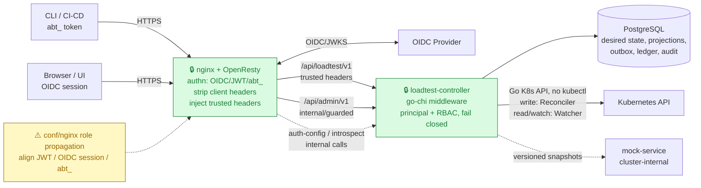
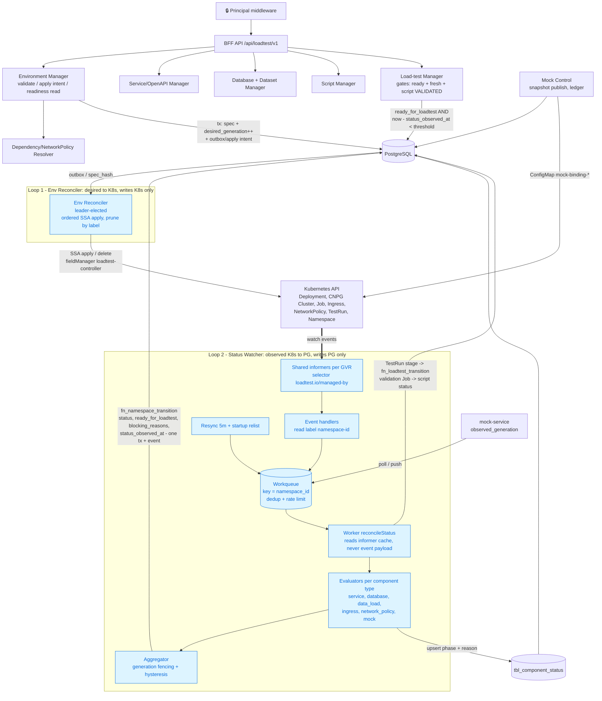
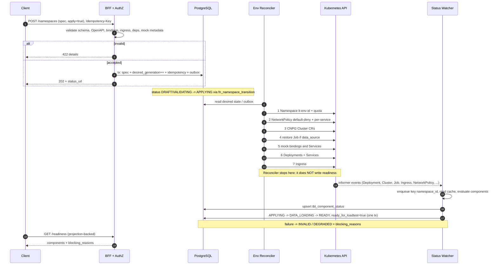
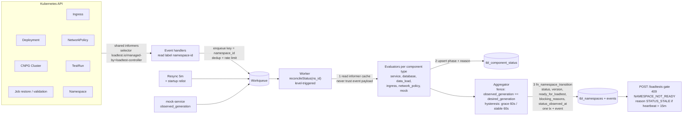
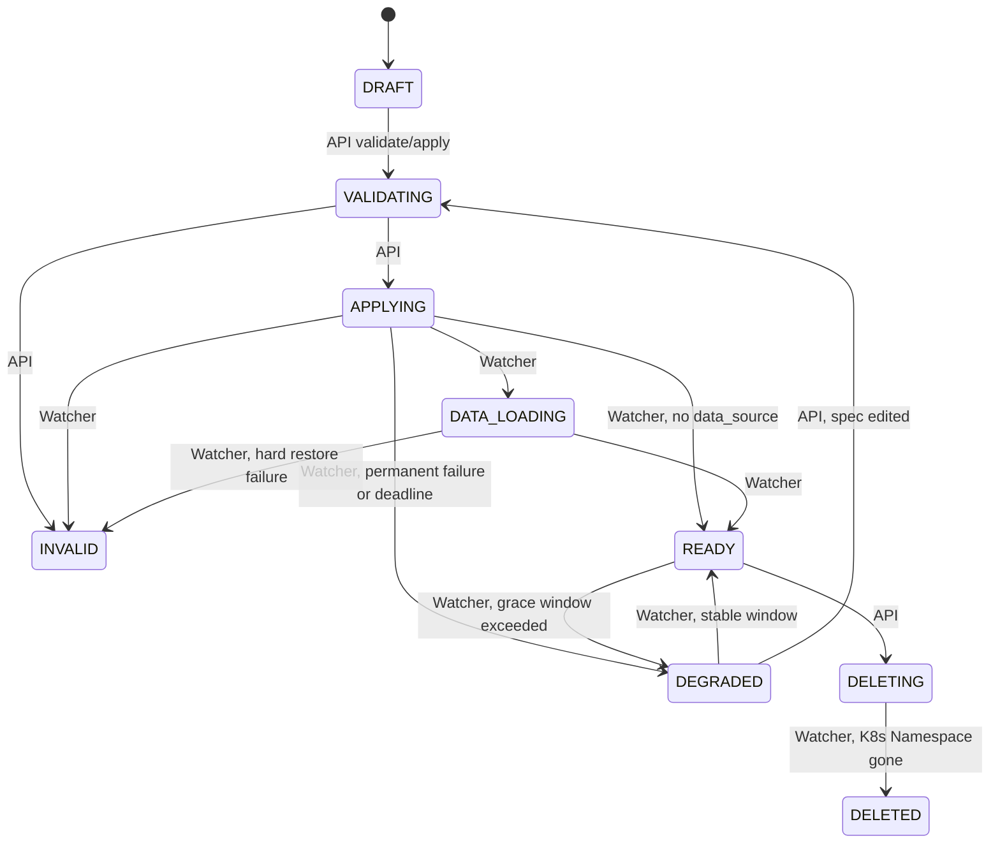
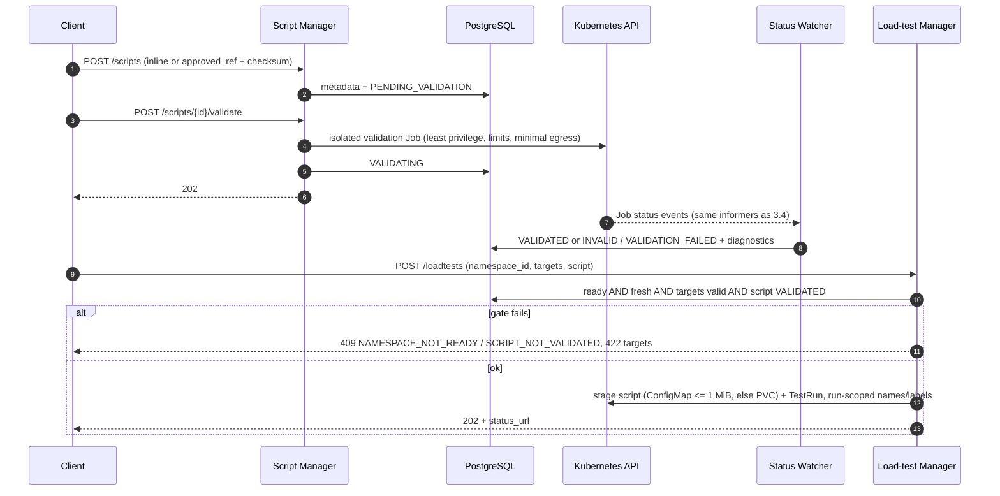
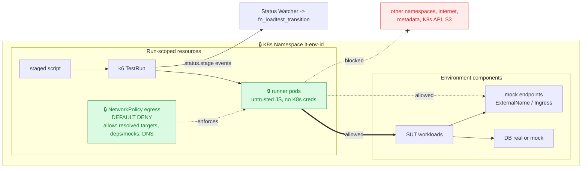

# Architecture — Self-Service Ephemeral Load Testing Platform (MVP BFF)

This document defines the **MVP architecture**. The model is **namespace-first**: an **Environment** (API path segment `/namespaces`) is the top-level definition containing every component needed for load testing; load tests are defined only against a **READY** Environment.

**Primary design & contracts**
- [`namespace-management-api.md`](namespace-management-api.md) — namespace-first model, component CRUD, readiness API.
- [`bff-loadtest-api-spec.md`](bff-loadtest-api-spec.md) — BFF REST contract (`/api/loadtest/v1`).
- [`loadtest-manager-api.md`](loadtest-manager-api.md) — load-test run lifecycle (gated by readiness).
- [`k8s-orchestration.md`](k8s-orchestration.md) — **desired → K8s** loop (Env Reconciler): render/SSA, component→resource mapping, ownership/prune, RBAC.
- [`namespace-status-watcher.md`](namespace-status-watcher.md) — **observed K8s → PG** loop (Status Watcher): component status projection, namespace aggregation, generation fencing, fail-closed staleness gate.
- [`k6-operator-go-client.md`](k6-operator-go-client.md) — run load via k6-operator `TestRun` using the Go K8s API (no `kubectl`).
- [`mock-service-api.md`](mock-service-api.md) — separate mock data plane.
- [`nginx-oidc-auth.md`](nginx-oidc-auth.md), [`admin-oidc-integration-api.md`](admin-oidc-integration-api.md), [`secrets-management.md`](secrets-management.md) — edge auth, `/api/admin/v1`, SOPS/field-level secrets.
- [`database-schema.md`](database-schema.md) — schema source of truth notes (`sql/` migrations are authoritative).
- [`harness-testing.md`](harness-testing.md) — ACID / fault-injection harness (release gate). [`mvp-status.md`](mvp-status.md) — what is implemented today.
- Component detail: [`service-management-api.md`](service-management-api.md), [`database-management-api.md`](database-management-api.md).

**MVP stack (`AGENTS.MD`):** Go + go-chi, Swagger/OpenAPI, PostgreSQL (`sql/` migrations), nginx (`conf/nginx`) for routing/auth, Docker Compose, k6 perf testing. `sources/` is reference-only.

## 1. Goals

- Self-service BFF API to define ephemeral test environments and run load tests safely.
- **The Environment defines everything** (services, databases, ingress, dependencies/NetworkPolicy, mocks, datasets).
- **Each service has its own OpenAPI**; a load test declares which operations it targets.
- A load test provides the **k6 JS script**.
- Safety: Environment is applied and **READY** (observed, not assumed) before any run.
- Security: tenant isolation always; owner-only by default; `admin` cross-owner within tenant; dependency-derived NetworkPolicy; network-enforced runner egress; TTL/cleanup.

## 2. Domain model

```text
Environment (API: /namespaces; 1:1 with K8s Namespace lt-env-<namespace_id>)
├── spec / desired definition
│   ├── services[]   deploy config, openapi (REQUIRED), database_bindings[], dependencies[], mock?
│   ├── databases[]  engine/operator, data_source (dataset restore), mock?
│   ├── ingress[]    host/path -> service_id/port
│   └── dependency/network policy intent
├── status (projection written by the Status Watcher)
│   ├── DRAFT | VALIDATING | INVALID | APPLYING | DATA_LOADING | READY | DEGRADED | DELETING | DELETED
│   ├── ready_for_loadtest (gate), blocking_reasons, status_observed_at (watcher heartbeat)
│   ├── desired_generation (bumped by spec change/apply)
│   └── tbl_component_status: 1 row per component (phase, observed_generation, reason)
└── load tests[] (only when ready_for_loadtest=true and status is fresh)
    ├── targets[]  service_id + operation (from OpenAPI)
    ├── script     JS/k6 (inline or approved ref, VALIDATED)
    └── load_config, status, TTL/cleanup
```

### Key rules
1. **Environment-first:** define the Environment, then CRUD components.
2. **Service OpenAPI required:** validated, indexed for `targets[]`; mock metadata is a behavior view over it.
3. **Dependencies → NetworkPolicy** per service (least privilege, default deny).
4. **Readiness is observed, not declared:** `ready_for_loadtest` is computed by the Status Watcher from live K8s state with generation fencing; the gate also fails closed when the watcher heartbeat is stale (`STATUS_STALE`).
5. **Load test clarity:** every run = ready namespace + targets + JS script + load config.
6. **One writer per direction:** the Env Reconciler writes **K8s only**; the Status Watcher writes **PG only**. They communicate only through the DB (`desired_generation` / `observed_generation`, `spec_hash`).

## 2.1 Deployment units (locked split)

| | `loadtest-controller` (control plane) | `mock-service` (data plane) |
|---|---|---|
| Source | `cmds/loadtest-controller/` + `pkgs/*` | `cmds/mock-service/` + `pkgs/*` |
| Role | BFF APIs, CRUD, dataset/script/loadtest lifecycle, OpenAPI validation, **Env Reconciler**, **Status Watcher**, run reconciler/reaper, RBAC | Mock HTTP/DB-profile behavior: routing, variants, latency injection, pool concurrency, metrics |
| Load profile | Low/bursty | High during load tests; latency-sensitive |
| Source of truth | PostgreSQL | **No DB writes on hot path**; in-memory snapshot by `generation`/`schema_version` |
| Scale | Few replicas; **leader election**: Reconciler/reaper run on the leader; Watcher replicas all keep informer caches, only the leader (or a shard by `namespace_id` hash) writes PG | Horizontal by pool class |
| Ingress | nginx → controller with trusted headers | **No public ingress**; cluster-internal only |
| Failure isolation | Controller down: existing mock snapshots keep serving; status goes stale → gate fails closed | Down/degraded: namespace becomes `DEGRADED`; new runs blocked |

**Interaction boundary:** controller stores canonical mock metadata in components and publishes versioned snapshot/binding config (`schema_version`, `namespace_id`, `generation`). `mock-service` swaps atomically and reports `observed_generation`/health, which the Watcher consumes as the `mock` component status. It never writes PostgreSQL nor makes authz decisions.

**Repository layout** (✅ exists today per `mvp-status.md`, 🔜 planned):
```text
cmds/
  loadtest-controller/   ✅ go-chi BFF; wires reconcilers
  mock-service/          ✅ data plane (mockruntime snapshot serving, plans/21 PR D)
pkgs/
  authz/                 ✅ trusted headers -> Principal, RBAC, fail-closed
  adminapi/              ✅ tenant-id, auth-config, introspect, abt_ tokens
  namespace/             ✅ CRUD, idempotency, ETag, validate/apply/readiness
  serviceopenapi/        ✅ OpenAPI validate + targets index
  script/                ✅ upload + async validation workers
  loadtest/              ✅ gates + lifecycle + run reconciler
  runner/                ✅ Runner interface: Local (k6) | K8s 🔜
  secrets/               ✅ SOPS env resolver + AES-GCM
  store/                 ✅ GORM models + migrations + Transition (only Raw SQL point)
  testutil/              ✅ NewServer (real composition)
  k8s/                   ✅ Client interface (dynamic client + Fake + fault injection) — plans/21 PR A
  envreconciler/         ✅ desired -> K8s (SSA render/apply in locked order, prune) — plans/21 PR B
  statuswatcher/         ✅ evaluators, projection (tbl_component_status), aggregator, hysteresis — plans/21 PR C + plans/22 (Watch→workqueue event source, apply_deadline, unreliable flag)
  mockcontrol/, mockruntime/ ✅ binding ConfigMaps + ExternalName wiring; snapshot runtime — plans/21 PR D
docs/  plans/  sql/  tests/
```

## 3. Diagrams

**Legend:** 🔒 locked, ⚠️ open/risk, ✅ normal flow.
**Locked decisions:** (1) 1 Environment = 1 K8s Namespace; (2) runner egress is network-enforced (default deny); (3) OIDC/nginx auth + Go middleware RBAC; (4) mock is a separate data plane; (5) **two separated loops** — Reconciler (desired→K8s) and Watcher (observed→PG); (6) manifests rendered in Go + SSA, no Helm for SUT (ADR-004).

### 3.1 Context & trust boundary



### 3.2 Control plane components (incl. the two loops)



Step-by-step detail of Loop 2: §3.4.

**Review:** the Watcher never writes K8s and the Reconciler never writes readiness to PG. A dead Watcher can only make status stale (gate fails closed); it cannot damage the cluster.

### 3.3 Environment lifecycle (create → READY)



### 3.4 Status Watcher: how K8s cluster events become namespace status



**Flow, step by step**
1. **Subscribe.** Shared informers (one per GVR) filter by `loadtest.io/managed-by=loadtest-controller`. Every replica holds the cache; only the leader writes PG (or shard by `namespace_id` hash).
2. **Enqueue, don't interpret.** A handler only reads the `loadtest.io/namespace-id` label and enqueues that key (deduplicated, rate-limited). Resync (5m) and startup relist are the safety net, so dropped, duplicated or reordered events still converge (`WATCH-01/02`).
3. **Recompute from cache.** The worker re-evaluates all components of the namespace from the informer cache. Readiness per component type:

   | Component | READY when |
   |---|---|
   | service | `observedGeneration == generation`, `Available=True`, `availableReplicas >= replicas`, `spec_hash` matches |
   | database | CNPG `Ready=True`, app secret exists (name only) |
   | data_load | restore Job `Complete=True` and verify passed |
   | ingress | exists and `spec_hash` matches |
   | network_policy | full expected set exists with matching `spec_hash` (K8s has no status) |
   | mock | `observed_generation == snapshot generation` |

4. **Generation fencing.** A component counts READY only if its observed generation equals the namespace `desired_generation`; otherwise it is at most `PROGRESSING` (`WATCH-03`).
5. **Aggregate and write atomically.** Component rows are upserted, then `fn_namespace_transition` writes status, version, `ready_for_loadtest`, `blocking_reasons` and the event in one transaction. Illegal transitions raise; the watcher logs and recomputes on the next pass (`WATCH-04`).
6. **Hysteresis.** READY→DEGRADED only after a required component is not READY for the grace window (60s); DEGRADED→READY only after a stable window (60s) (`WATCH-06`).
7. **Heartbeat / fail-closed.** `status_observed_at` is updated on every reconcile/resync. If it is older than the staleness threshold (15m = 3× resync), `POST /loadtests` returns `409 NAMESPACE_NOT_READY` / `STATUS_STALE` (`WATCH-05`).
8. **One watcher, many consumers.** The same informers feed `fn_loadtest_transition` (TestRun `status.stage`) and script validation Job status — no second watcher.

**DEGRADED during a RUNNING load test:** the run continues and is flagged `namespace_degraded_at` (result unreliable); the gate still applies at run-creation time only.

### 3.5 Namespace status machine (owner of each transition)



The four transitions missing from the current seed (`APPLYING→READY`, `APPLYING→DEGRADED`, `DATA_LOADING→INVALID`, `DEGRADED→READY`) are added in the plan-21 migration (see `namespace-status-watcher.md` §2).

### 3.6 Script validation & staging



Large/S3 scripts: PVC ownership/lifecycle and scoped credentials remain open (⚠️).

### 3.7 Load-test execution & runner egress (security focus)



Status sources: today the `LocalRunner` is reconciled by polling (2s). With the K8s runner, `TestRun.status.stage` arrives through the Watcher.

### 3.8 Review checklist

| Area | Review question | Status |
|---|---|---|
| Trust boundary | nginx strips client identity headers; backend fails closed? | 🔒 design / ⚠️ `conf/nginx` alignment |
| AuthN/AuthZ | Go middleware canonical principal + RBAC, role verified from DB | ✅ implemented |
| Role propagation | `X-User-Role` consistent across JWT / OIDC session / `abt_` | ⚠️ |
| Env mapping | 1 Environment = 1 K8s Namespace, deterministic labels | 🔒 |
| Loop separation | Reconciler writes K8s only; Watcher writes PG only | 🔒 (plan 20/21) |
| Readiness source | projection-backed, generation fencing, hysteresis | 🔒 design / 🔜 impl (plan 21) |
| Fail-closed | stale heartbeat → `STATUS_STALE` | 🔒 design / 🔜 impl |
| Runner egress | default deny, resolved targets + deps + DNS | 🔒 / ⚠️ CNI details |
| Script validation | approved refs, checksum, isolated Job, watcher projection | ✅ flow / ⚠️ allowlist + creds |
| Large scripts | PVC staging, ownership, presigned creds | ⚠️ |
| Parallel runs | quota, label isolation, owner refs in shared namespace | ⚠️ |
| Mock | snapshot contract, `observed_generation` feeds Watcher | ✅ model / ⚠️ contract + scope |
| Mock benchmark | `rps_per_core` / overhead before runtime choice | ⚠️ |

## 4. Component responsibilities

| Component | Responsibility |
|---|---|
| HTTP API (go-chi + Swagger) | CRUD, readiness read, load-test create/manage, consistent errors. |
| Auth middleware / policy | Principal from trusted headers; tenant isolation; owner/admin RBAC; 401/403/404 policy. |
| Environment manager | Store/validate desired spec, bump `desired_generation`, write apply intent (outbox). **Reads** readiness from projection; does not compute it. |
| Service/OpenAPI manager | Validate/store services, index operations, validate `service.mock`. |
| Database / Dataset manager | CRUD, bindings, `database.mock`, dataset refs and restore policy. |
| Dependency/NetworkPolicy resolver | Validate graph; produce policy intent for the Reconciler; expose effective policy. |
| **Env Reconciler** | Level-triggered desired → K8s: ordered SSA apply, prune by label, leader-elected. Never writes readiness. See `k8s-orchestration.md`. |
| **Status Watcher** | Informers on managed resources + resync; evaluators per component; generation-fenced aggregation; atomic `fn_namespace_transition`; heartbeat; also drives `fn_loadtest_transition` and script validation status. See `namespace-status-watcher.md`. |
| Load-test manager | Gates (ready, **fresh**, targets, script), guardrails, persist run, runner start, reaper. |
| Runner | `Local` (k6 binary) today; `K8s` (TestRun via dynamic client) planned. |
| Mock operator (controller) | Materialize mock metadata → versioned snapshots; ledger; consume `observed_generation`. |
| `mock-service` (separate) | Serve mocks; no PG writes, no user RBAC, no public ingress. |
| Telemetry adapter | Authz-scoped logs/metrics/events; redact secrets. |


## 5. Codebase Framework & Layering

To ensure maintainability and testability, all packages in  follow a strict 3-layer architecture. This separation ensures that business logic is decoupled from transport (HTTP) and storage (SQL).

### 5.1 Layer Responsibilities (target shape)

| Layer | Responsibility | Dependencies | Key Constraints |
| :--- | :--- | :--- | :--- |
| **API / Handler** | HTTP transport, request parsing, basic schema validation, response formatting. | $
ightarrow$ Service | No business logic; No direct DB access. |
| **Service** | Core business logic, OpenAPI validation, dependency graph resolution, state transition orchestration. | $
ightarrow$ Repo | No HTTP knowledge; No raw SQL. |
| **Repo / Store** | Data persistence, complex SQL queries, transaction management. | $
ightarrow$ Database | No business logic; Returns domain models. |

### 5.2 Current Codebase Organization (2026-11-08)

The codebase is organized by domain boundary, not strictly by the API → service → repo layering above. The layering is a target shape, applied incrementally when a concrete trigger fires.

#### 5.2.1 Blocks at a glance

    cmds/                      Entry points (composition roots only)
    ├── loadtest-controller/   Control plane: router, middleware, loop wiring
    └── mock-service/          Data plane: serves mock snapshots
    
    pkgs/
    ├── A. API domains         namespace · readiness · serviceopenapi · script · loadtest · adminapi
    ├── B. Reconcile loops     envreconciler (desired → K8s) · statuswatcher (observed → PG)
    ├── C. Runtime adapters    k8s · runner
    ├── D. Mock                mockcontrol (controller side) · mockruntime (mock-service side)
    ├── E. Cross-cutting       authz · secrets · idempotency
    ├── F. Persistence         store
    └── G. Test support        testutil
    
    tests/                     harness/ · sql/ · nginx/ · perf/ · fixtures/

#### 5.2.2 Block responsibilities

| Block | Responsibility | Must not |
|---|---|---|
| Entry points | Wire components and read config/env. | Contain business rules or SQL. |
| API domains | HTTP handlers and domain rules. | Import each other's internals; loadtest must not recompute namespace state. |
| Reconcile loops | Desired→K8s and observed→PG loops. | Be merged; shared code is pure helpers only. |
| Runtime adapters | Narrow interfaces to external systems. | Leak client-go types into domains. |
| Mock | mockcontrol publishes bindings/ledger; mockruntime serves in-memory snapshots. | mockruntime must not write DB or make authz decisions. |
| Cross-cutting | Identity/RBAC, secret handling, and idempotency replay. | Be re-implemented per handler. |
| Persistence | Models, migrations, transactions, and the only raw-SQL transition point. | Contain business rules or duplicate transitions. |
| Test support | Real composition for integration and harness tests. | Rebuild router, middleware, or auth. |

### 5.3 Dependency rules

    cmds → A, B, D(controller side), E, F
    A    → E, F, C(runner only), serviceopenapi, readiness
    B    → C(k8s), F, D(pure helpers only: mockcontrol.DecodeMockDef,
             envreconciler render/HashSpec/PolicySpecOf)
    D    → C(k8s), F
    E    → F, httpx (error/response shaping only)
    F    → (no domain imports)

Status changes happen only through store transitions. The Reconciler never writes readiness; the Watcher never writes K8s. Before cross-package refactors, update docs/plans, re-index CodeGraph, and inspect call chains for bypasses.

### 5.4 Known deviations and staged refactors (MVP-scoped)

| Stage | Deviation | Trigger | Action |
|---|---|---|---|
| 1 | namespace is the largest package. | Next readiness/component feature. | Split readiness projection/gate first. ✅ **Done (plans/25)** — `pkgs/readiness` (Gates/ProjectionReport), namespace handlers gọi readiness.*. |
| 2 | loadtest mixes handlers, gates, lifecycle, and reconciler. | K8s runner or quota gate. | Keep policy/lifecycle; move mechanics to runner. |
| 3 | Some handlers use GORM models directly (~55 refs / 15 files, baseline 2026-11-08). | Second query consumer or transaction need. | Move the query into store; avoid speculative interfaces. |
| 4 | Service/Repo interfaces are not universal. | Unit testing is blocked by DB coupling. | Introduce an interface at that seam only. |

Out of scope for MVP: full hexagonal restructuring, splitting store per aggregate, or shared libraries across the two reconciliation loops.


### 5.2.1 Blocks at a glance

Codebase hiện có boundary theo domain tương đối rõ, nhưng chưa hoàn toàn theo mô hình `API → service/use-case → store` ở mục 4.1. Đây là baseline cho các lần review và refactor tiếp theo:

| Khu vực | Hiện trạng | Nhận xét / rủi ro |
|---|---|---|
| `cmds/loadtest-controller` | Composition root, wiring router, middleware, reconciler và worker | Giữ mỏng; không đưa business rule vào `main.go` hoặc orchestration wiring. |
| `cmds/mock-service` | Data-plane binary riêng, dùng `pkgs/mockruntime`/`pkgs/mockcontrol` | Không import `namespace`, `authz` hoặc controller store vào hot path. |
| `pkgs/namespace` | Handler, lifecycle, spec validation, component CRUD, readiness và projection/view | Package lớn nhất; khi mở rộng nên tách readiness, components và lifecycle theo boundary. |
| `pkgs/loadtest` | Handler, create gate, lifecycle, runner orchestration và reconciler | Tránh thành god package; policy ở đây, process/K8s adapter ở `pkgs/runner`. |
| `pkgs/envreconciler` / `pkgs/statuswatcher` | Hai loop đã tách desired→K8s và observed→PG | Không gộp lại; shared code chỉ nên là model/render/validation thuần. |
| `pkgs/store` | GORM models, migrations, transaction helpers và transition SQL | `transitions.go` là điểm Raw SQL duy nhất; mọi status transition đi qua đây. |
| `pkgs/authz`, `pkgs/secrets`, `pkgs/idempotency` | Cross-cutting packages dùng chung | Không nhân bản policy trong từng handler; giữ fail-closed và replay semantics nhất quán. |
| `pkgs/testutil` / `tests/harness` | Dùng composition thật cho integration và harness | Không dựng router/middleware/auth riêng trong từng test. |

Nguyên tắc sắp xếp:

- Handler chỉ parse request, gọi use-case và map lỗi; không thêm transaction orchestration hoặc query DB trực tiếp.
- `namespace` là aggregate boundary của environment; `loadtest` chỉ dùng readiness/gates, không tự tính lại trạng thái namespace.
- `envreconciler` chỉ ghi K8s; `statuswatcher` chỉ ghi projection/PG.
- `store` chứa repository/query và transaction primitives; transition map không được nhân bản ở handler, reconciler hoặc test helper.
- Code mới phải có test đúng tầng: pure rule ở unit, SQL/transaction ở integration, fault/convergence ở harness.
- Trước refactor cross-package, cập nhật docs/plan; sau đó re-index CodeGraph và kiểm tra call-chain để tránh bypass transition, authz, readiness hoặc idempotency.

Ưu tiên refactor hiện tại: (1) tách readiness projection/gate khỏi `pkgs/namespace`; (2) giữ `pkgs/loadtest` tập trung vào policy/lifecycle; (3) chuẩn hóa repository interfaces để handler không phụ thuộc trực tiếp vào GORM model ngoài `pkgs/store`.

### 5.5 Testing strategy per layer

- **API Tests**: Focus on HTTP contracts, status codes, and error responses (Mock Service). 
- **Service Tests ( )**: The primary focus of the Harness. Test business rules, edge cases, and state transitions (Mock Repo or Integration DB). 
- **Repo Tests**: Verify SQL correctness, constraints, and performance (Real DB). 

## 6. Core flows

### 6.1 Define Environment
1. Client creates the Environment (full `spec` and/or component CRUD).
2. BFF validates schema, OpenAPI, bindings, ingress, deps, NetworkPolicy renderability.
3. On apply: one tx stores spec, bumps `desired_generation`, writes idempotency + outbox; status → `APPLYING`.
4. **Env Reconciler** applies resources in order (§3.3). **Status Watcher** observes K8s and moves the namespace to `DATA_LOADING` / `READY` / `DEGRADED` / `INVALID` with `blocking_reasons`.
5. `GET /readiness` serves the projection.

### 6.2 Define/trigger load test
1. `POST /loadtests` with `namespace_id`, `targets[]`, `script`, `load_config`.
2. Authz, then **gate**: `ready_for_loadtest=true` **and** `now - status_observed_at <= staleness_threshold`; else `409 NAMESPACE_NOT_READY` (reason may be `STATUS_STALE`).
3. Resolve `targets[]` against OpenAPI; validate script (+ `VALIDATED` for refs); guardrails/quota.
4. Persist run, transition in tx, `Runner.Start`; return `202`.
5. Reconcile to terminal state (`COMPLETED/FAILED/STOPPED/TIMEOUT_CLEANED/CLEANUP_FAILED`); reaper cleans up.

## 7. API surface (summary)

Base `/api/loadtest/v1` (details in `bff-loadtest-api-spec.md`): namespaces (+ readiness/validate/apply/events), components (`services`, `databases`, `ingress`, `dependencies`, `network-policies`), scripts, loadtests, datasets, mock status/pools, `/me`, `/guardrails`. Control plane: `/api/admin/v1`.

## 8. Security & operations

- Integrity/fault harness is a release gate: [`harness-testing.md`](harness-testing.md) (includes `WATCH-01..06`).
- Trust only nginx-injected identity at the boundary; fail closed; never trust client owner/tenant.
- OpenAPI, scripts, refs are untrusted and size-limited; runner egress is network-enforced; no platform credentials in runners.
- Secrets via SOPS env / references; never in DB (`secrets-management.md`).
- Async + idempotent mutations (`Idempotency-Key`), optimistic concurrency (ETag/`If-Match`), TTL/force-stop cleanup, audit for admin actions.
- **Operational signals for the Watcher:** heartbeat age per namespace, workqueue depth, resync duration, illegal-transition count, time-in-`APPLYING`.

## 9. MVP decisions and open items

### Locked
1. 1 Environment = 1 K8s Namespace (`lt-env-<namespace_id>`, deterministic labels).
2. Runner egress network-enforced (not advisory).
3. OIDC/nginx auth + Go middleware RBAC; `abt_` service-account token; `tenant_id` boundary.
4. Mock = separate `mock-service` data plane driven by desired-state snapshots.
5. Two separated loops (Reconciler → K8s, Watcher → PG), shared only via DB; level-triggered with generation fencing and fail-closed staleness gate. **Plans/26 bổ sung:** apply ban đầu do request path CHỦ ĐỘNG trigger theo thứ tự ngoài→trong (hierarchical `Applier` — namespace apply trước rồi gọi `Apply()` của con: NetworkPolicy → operator CR → ConfigMap/Secret/SA → Deployment/Service → HPA → Ingress; `ApplyNow` hook); Reconciler loop giữ vai trò retry/drift-convergence. Watcher chuyển trạng thái OBSERVED (component phase PENDING/PROGRESSING/READY/FAILED + namespace transition qua `fn_namespace_transition`) — object chỉ READY khi TẤT CẢ con required READY, ngược lại tiến về DEGRADED.
6. Manifests rendered in Go + SSA (ADR-004); no Helm in MVP.
7. A RUNNING load test continues when the namespace goes DEGRADED; its result is flagged unreliable.

### Open
1. Active-run behavior when mutating an Environment (block vs generation snapshot).
2. NetworkPolicy baseline merge with cluster DNS/metrics rules (CNI specifics).
3. Concrete quotas/limits (OpenAPI/script size, vusers/duration/TTL, env TTL, validation Job limits).
4. Operation identifier format (`operationId` vs `method+path`).
5. Dataset/restore details (credential model, PII scan, retention/owner handoff, restore Job egress).
6. Mock MVP scope, snapshot contract, endpoint DNS/NetworkPolicy templates.
7. Watcher sharding vs single leader; `component_id` type in `tbl_component_status` (text vs UUID).
8. Legacy/global endpoint compatibility.
9. Environment TTL (reaper currently covers runs only).
