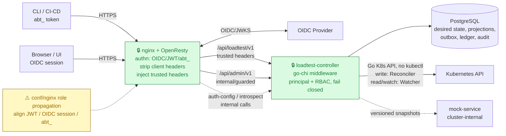
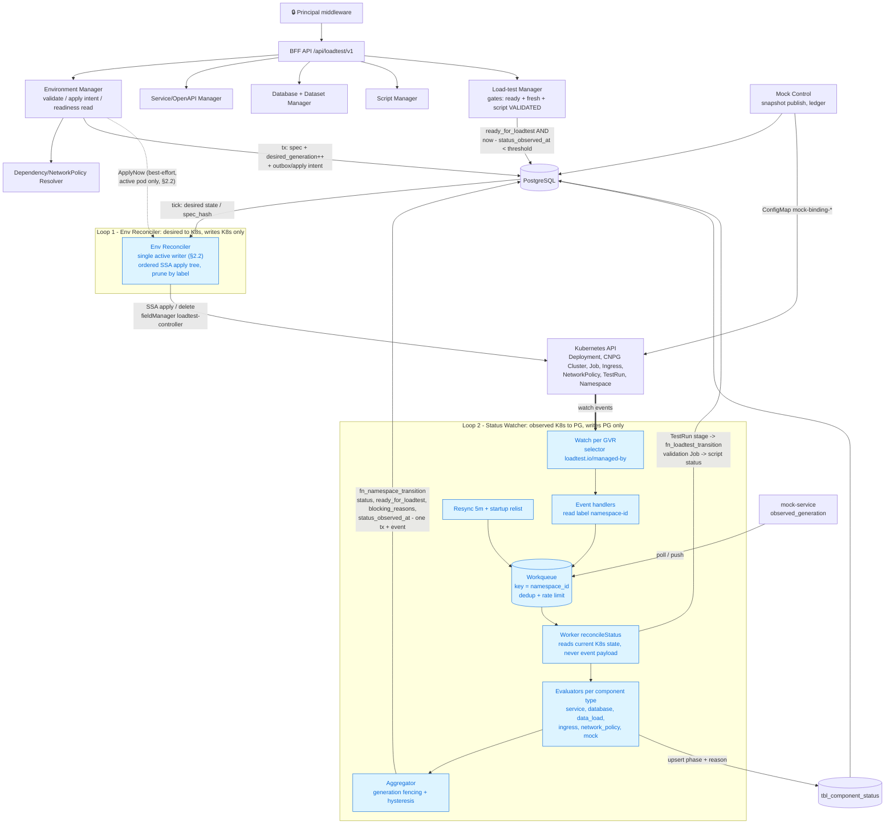
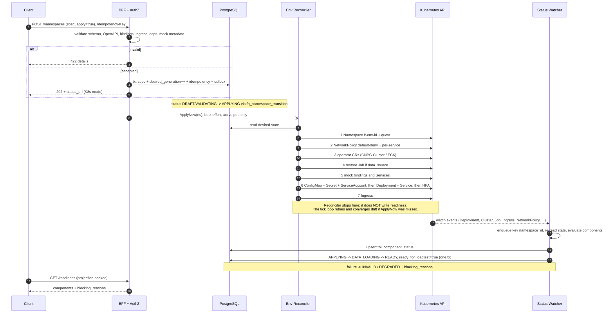
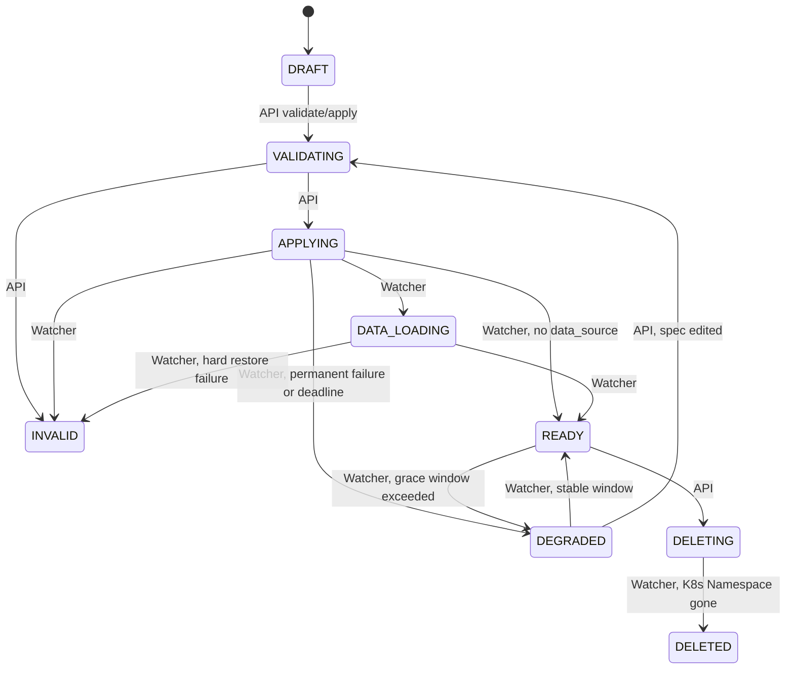
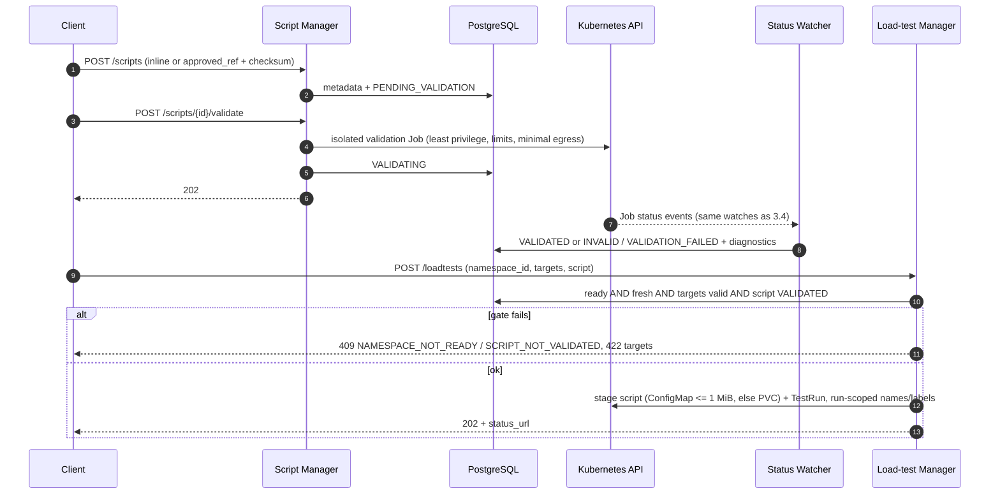
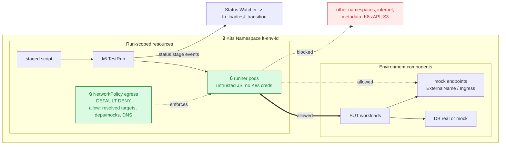

# Architecture — Self-Service Ephemeral Load Testing Platform (MVP BFF)

This document defines the **MVP architecture**. The model is **namespace-first**: an **Environment** (API path segment `/namespaces`) is the top-level definition containing every component needed for load testing; load tests are defined only against a **READY** Environment.

**Primary design & contracts**
- [`namespace-management-api.md`](namespace-management-api.md) — namespace-first model, component CRUD, readiness API.
- [`bff-loadtest-api-spec.md`](bff-loadtest-api-spec.md) — BFF REST contract (`/api/loadtest/v1`).
- [`loadtest-manager-api.md`](loadtest-manager-api.md) — load-test run lifecycle (gated by readiness).
- [`k8s-orchestration.md`](k8s-orchestration.md) — **desired → K8s** loop (Env Reconciler): render/SSA, component→resource mapping, ownership/prune, RBAC.
- [`namespace-status-watcher.md`](namespace-status-watcher.md) — **observed K8s → PG** loop (Status Watcher): component status projection, namespace aggregation, generation fencing, fail-closed staleness gate.
- [`k6-operator-go-client.md`](k6-operator-go-client.md) — run load via k6-operator `TestRun` using the Go K8s API (no `kubectl`).
- [`mock-service-api.md`](mock-service-api.md) — separate mock data plane.
- [`nginx-oidc-auth.md`](nginx-oidc-auth.md), [`admin-oidc-integration-api.md`](admin-oidc-integration-api.md), [`secrets-management.md`](secrets-management.md) — edge auth, `/api/admin/v1`, SOPS/field-level secrets.
- [`database-schema.md`](database-schema.md) — schema source of truth notes (`sql/` migrations are authoritative).
- [`harness-testing.md`](harness-testing.md) — ACID / fault-injection harness (release gate). [`mvp-status.md`](mvp-status.md) — what is implemented today.
- Component detail: [`service-management-api.md`](service-management-api.md), [`database-management-api.md`](database-management-api.md).

**MVP stack (`AGENTS.MD`):** Go + go-chi, Swagger/OpenAPI, PostgreSQL (`sql/` migrations), nginx (`conf/nginx`) for routing/auth, Docker Compose, k6 perf testing. `sources/` is reference-only.

## 1. Goals

- Self-service BFF API to define ephemeral test environments and run load tests safely.
- **The Environment defines everything** (services, databases, ingress, dependencies/NetworkPolicy, mocks, datasets).
- **Each service has its own OpenAPI**; a load test declares which operations it targets.
- A load test provides the **k6 JS script**.
- Safety: Environment is applied and **READY** (observed, not assumed) before any run.
- Security: tenant isolation always; owner-only by default; `admin` cross-owner within tenant; dependency-derived NetworkPolicy; network-enforced runner egress; TTL/cleanup.

## 2. Domain model

```text
Environment (API: /namespaces; 1:1 with K8s Namespace lt-env-<namespace_id>)
├── spec / desired definition
│   ├── services[]   deploy config, openapi (REQUIRED), database_bindings[], dependencies[], mock?
│   ├── databases[]  engine/operator, data_source (dataset restore), mock?
│   ├── ingress[]    host/path -> service_id/port
│   └── dependency/network policy intent
├── status (projection written by the Status Watcher)
│   ├── DRAFT | VALIDATING | INVALID | APPLYING | DATA_LOADING | READY | DEGRADED | DELETING | DELETED
│   ├── ready_for_loadtest (gate), blocking_reasons, status_observed_at (watcher heartbeat)
│   ├── desired_generation (bumped by spec change/apply)
│   └── tbl_component_status: 1 row per component (phase, observed_generation, reason)
└── load tests[] (only when ready_for_loadtest=true and status is fresh)
    ├── targets[]  service_id + operation (from OpenAPI)
    ├── script     JS/k6 (inline or approved ref, VALIDATED)
    └── load_config, status, TTL/cleanup
```

### Key rules
1. **Environment-first:** define the Environment, then CRUD components.
2. **Service OpenAPI required:** validated, indexed for `targets[]`; mock metadata is a behavior view over it.
3. **Dependencies → NetworkPolicy** per service (least privilege, default deny).
4. **Readiness is observed, not declared:** `ready_for_loadtest` is computed by the Status Watcher from live K8s state with generation fencing; the gate also fails closed when the watcher heartbeat is stale (`STATUS_STALE`).
5. **Load test clarity:** every run = ready namespace + targets + JS script + load config.
6. **One writer per direction:** the Env Reconciler writes **K8s only**; the Status Watcher writes **PG only**. They communicate only through the DB (`desired_generation` / `observed_generation`, `spec_hash`).
7. **One active writer per Environment:** background workers (apply, prune, watcher, reaper) must never run concurrently for the same Environment. MVP guarantees this with a single controller pod; the HA path is defined in §2.2.

## 2.1 Deployment units (locked split)

| | `loadtest-controller` (control plane) | `mock-service` (data plane) |
|---|---|---|
| Source | `cmds/loadtest-controller/` + `pkgs/*` | `cmds/mock-service/` + `pkgs/*` |
| Role | BFF APIs, CRUD, dataset/script/loadtest lifecycle, OpenAPI validation, **Env Reconciler**, **Status Watcher**, run reconciler/reaper, RBAC | Mock HTTP/DB-profile behavior: routing, variants, latency injection, pool concurrency, metrics |
| Load profile | Low/bursty | High during load tests; latency-sensitive |
| Source of truth | PostgreSQL | **No DB writes on hot path**; in-memory snapshot by `generation`/`schema_version` |
| Scale | **MVP: exactly 1 pod** (`replicas: 1`, `strategy: Recreate`). HTTP is stateless and could scale out, but the background workers are not safe to run twice — see §2.2. | Horizontal by pool class |
| Ingress | nginx → controller with trusted headers | **No public ingress**; cluster-internal only |
| Failure isolation | Controller down: existing mock snapshots keep serving; status goes stale → gate fails closed | Down/degraded: namespace becomes `DEGRADED`; new runs blocked |

**Interaction boundary:** controller stores canonical mock metadata in components and publishes versioned snapshot/binding config (`schema_version`, `namespace_id`, `generation`). `mock-service` swaps atomically and reports `observed_generation`/health, which the Watcher consumes as the `mock` component status. It never writes PostgreSQL nor makes authz decisions.

**Repository layout** (✅ exists today per `mvp-status.md`, 🔜 planned): see §5.2 for the block view.
```text
cmds/
  loadtest-controller/   ✅ go-chi BFF; wires reconcilers
  mock-service/          ✅ data plane (mockruntime snapshot serving, plans/21 PR D)
pkgs/
  authz/                 ✅ trusted headers -> Principal, RBAC, fail-closed
  adminapi/              ✅ tenant-id, auth-config, introspect, abt_ tokens
  namespace/             ✅ CRUD, idempotency, ETag, validate/apply
  readiness/             ✅ desired-side readiness gates + projection report (plans/25)
  serviceopenapi/        ✅ OpenAPI validate + targets index
  script/                ✅ upload + async validation workers
  loadtest/              ✅ gates + lifecycle + run reconciler
  runner/                ✅ Runner interface: Local (k6) | K8s 🔜
  secrets/               ✅ SOPS env resolver + AES-GCM
  store/                 ✅ GORM models + migrations + Transition (only Raw SQL point) + *_lifecycle.go state machines
  testutil/              ✅ NewServer (real composition)
  k8s/                   ✅ Client interface (dynamic client + Fake + fault injection) — plans/21 PR A
  envreconciler/         ✅ desired -> K8s (hierarchical Applier tree, SSA, prune) — plans/21 PR B, plans/26
  statuswatcher/         ✅ evaluators, projection (tbl_component_status), aggregator, hysteresis — plans/21 PR C + plans/22
  mockcontrol/, mockruntime/ ✅ binding ConfigMaps + ExternalName wiring; snapshot runtime — plans/21 PR D
docs/  plans/  sql/  tests/
```

## 2.2 Background workers and the single-writer rule

Most of the control plane's real effects happen **outside the request path**, in goroutines that start with the process. Every pod runs them unless told otherwise, so the number of controller pods is a **correctness** question, not only a scale question.

| Background activity | Writes to | Entry point |
|---|---|---|
| Initial apply (`ApplyNow`, plans/26) | K8s | HTTP handler goroutine on `apply` / create-with-spec, best-effort, in the pod that received the request |
| Env Reconciler tick (retry, drift, prune) | K8s | background loop (batch of 100 namespaces per tick) |
| Environment teardown | K8s, then PG | `DELETE` handler (K8s Namespace delete) + Watcher (`DELETING → DELETED`) |
| Status Watcher workers | PG (`tbl_component_status`, `fn_namespace_transition`) | Watch → workqueue, plus resync |
| Run reconciler / reaper | PG + runner | background loop (2s poll) |
| Script validation workers | PG | worker pool |

### 2.2.1 What breaks with more than one active pod

- **Prune thrash:** pod A applies generation N; pod B, holding an older desired-state snapshot, prunes the resources A just created.
- **Race on teardown / double apply:** concurrent `DeleteEnv` and apply for the same Environment.
- **Duplicate status writes:** two watchers recompute and each try the same transition; the loser raises an illegal-transition error (safe, but noisy and it duplicates events).
- **Request-path bypass:** `ApplyNow` runs in whichever pod served the HTTP request. A leader election that only gates the background loops would **not** cover it.

Two points that are easy to get wrong:
- **A shared SSA field manager is not itself a conflict.** Identical manager + identical applied config converges. Keep one stable `fieldManager=loadtest-controller`. A per-pod manager name fragments field ownership, and fields removed by a later apply are then no longer pruned by SSA.
- **Rolling updates create overlap.** The default `RollingUpdate` briefly runs two pods, which is exactly the situation above.

### 2.2.2 MVP guard (current)

- Controller `Deployment`: `replicas: 1`, `strategy: Recreate` (never two pods at once, including during rollouts).
- Single-pod operation is documented as a **constraint**, not hidden: Open item 10 (§9).
- Status: ✅ deployment convention; ⚠️ not enforced in code.

### 2.2.3 Planned safety net (post-MVP, small): active/standby via a PostgreSQL advisory lock

Status: **proposed, not implemented.** The DB is already the only coordination channel between the two loops, so the guard uses it too.

- **Startup:** HTTP serves immediately on every pod. Background workers start only after `pg_try_advisory_lock(<controller-active key>)` succeeds on a **dedicated, non-pooled** connection. Standby pods retry every few seconds.
- **Self-fencing:** the lock is session-scoped, so it is released automatically if the pod dies or the connection drops. The holder health-checks that connection and **cancels all workers when it is lost**.
- **Request path:** `ApplyNow` runs only on the active pod. A standby pod just commits `desired_generation++` and returns `202`; the active pod's next tick applies it (the loop is the retry/convergence path already).
- **Why a DB lock rather than a K8s Lease:** it covers the request path and every worker with one mechanism, adds no RBAC, and creates no per-namespace Lease objects. A Lease (`client-go` leader election) is an equivalent alternative for the loops only; it would still need `ApplyNow` gated separately.
- **Caveat:** PgBouncer in transaction-pooling mode breaks session advisory locks; use a direct connection for this one.

### 2.2.4 Correctness must not depend on the lock alone

A lock or lease is never strict mutual exclusion (pauses, partitions, slow shutdowns). Backstops that make a brief overlap harmless:

1. Stable SSA field manager; apply is idempotent.
2. **Generation check before prune:** re-read `desired_generation` from the DB immediately before deleting; skip the prune if it changed since the snapshot was taken.
3. All status changes serialize on the row lock inside `fn_*_transition`; illegal or duplicate transitions raise and are retried by recomputation (`WATCH-04`).

### 2.2.5 Scale-out beyond one active pod (later)

Only if one active pod cannot keep up: per-Environment advisory lock keyed by `hash(namespace_id)` (or consistent-hash sharding by replica index). Not needed for MVP.

## 3. Diagrams

**Legend:** 🔒 locked, ⚠️ open/risk, ✅ normal flow.
**Locked decisions:** (1) 1 Environment = 1 K8s Namespace; (2) runner egress is network-enforced (default deny); (3) OIDC/nginx auth + Go middleware RBAC; (4) mock is a separate data plane; (5) **two separated loops** — Reconciler (desired→K8s) and Watcher (observed→PG); (6) manifests rendered in Go + SSA, no Helm for SUT (ADR-004); (7) one active controller pod in MVP (§2.2).

### 3.1 Context & trust boundary



### 3.2 Control plane components (incl. the two loops)



Step-by-step detail of Loop 2: §3.4.

**Review:** the Watcher never writes K8s and the Reconciler never writes readiness to PG. A dead Watcher can only make status stale (gate fails closed); it cannot damage the cluster. Both loops, plus `ApplyNow`, are covered by the single-writer rule in §2.2.

### 3.3 Environment lifecycle (create → READY)



In legacy mode (no cluster) the handler runs the synchronous `→ DATA_LOADING → READY` branch and returns `201`; this diagram is the K8s-mode flow.

### 3.4 Status Watcher: how K8s cluster events become namespace status


**Flow, step by step**
1. **Subscribe.** Watches (one per GVR) filter by `loadtest.io/managed-by=loadtest-controller`. In MVP there is one active controller, hence one writer (§2.2). Post-MVP, standby pods may keep warm caches, but only the active writer writes PG.
2. **Enqueue, don't interpret.** A handler only reads the `loadtest.io/namespace-id` label and enqueues that key (deduplicated, rate-limited). Resync (5m) and startup relist are the safety net, so dropped, duplicated or reordered events still converge (`WATCH-01/02`).
3. **Recompute from current state.** The worker re-evaluates all components of the namespace. Readiness per component type:

   | Component | READY when |
   |---|---|
   | service | `observedGeneration == generation`, `Available=True`, `availableReplicas >= replicas`, `spec_hash` matches |
   | database | CNPG `Ready=True`, app secret exists (name only) |
   | data_load | restore Job `Complete=True` and verify passed |
   | ingress | exists and `spec_hash` matches |
   | network_policy | full expected set exists with matching `spec_hash` (K8s has no status) |
   | mock | `observed_generation == snapshot generation` |

   A namespace is READY only when **all** required child components are READY; otherwise it moves toward DEGRADED.

4. **Generation fencing.** A component counts READY only if its observed generation equals the namespace `desired_generation`; otherwise it is at most `PROGRESSING` (`WATCH-03`).
5. **Aggregate and write atomically.** Component rows are upserted, then `fn_namespace_transition` writes status, version, `ready_for_loadtest`, `blocking_reasons` and the event in one transaction. Illegal transitions raise; the watcher logs and recomputes on the next pass (`WATCH-04`).
6. **Hysteresis.** READY→DEGRADED only after a required component is not READY for the grace window (60s); DEGRADED→READY only after a stable window (60s) (`WATCH-06`).
7. **Heartbeat / fail-closed.** `status_observed_at` is updated on every reconcile/resync. If it is older than the staleness threshold (15m = 3× resync), `POST /loadtests` returns `409 NAMESPACE_NOT_READY` / `STATUS_STALE` (`WATCH-05`).
8. **One watcher, many consumers.** The same watch infrastructure feeds `fn_loadtest_transition` (TestRun `status.stage`) and script validation Job status — no second watcher.

**DEGRADED during a RUNNING load test:** the run continues and is flagged `namespace_degraded_at` (result unreliable); the gate still applies at run-creation time only.

### 3.5 Namespace status machine (owner of each transition)



The four transitions that were missing from the original seed (`APPLYING→READY`, `APPLYING→DEGRADED`, `DATA_LOADING→INVALID`, `DEGRADED→READY`) were added in the plan-21 migration (see `namespace-status-watcher.md` §2). All status constants and caller-owner tables live in `pkgs/store/*_lifecycle.go` (§5.3).

### 3.6 Script validation & staging



Large/S3 scripts: PVC ownership/lifecycle and scoped credentials remain open (⚠️). The K8s path above is the target; today the MVP uses the Local runner and structural/`k6 inspect` validation workers.

### 3.7 Load-test execution & runner egress (security focus)



Status sources: today the `LocalRunner` is reconciled by polling (2s). With the K8s runner, `TestRun.status.stage` arrives through the Watcher.

### 3.8 Review checklist

| Area | Review question | Status |
|---|---|---|
| Trust boundary | nginx strips client identity headers; backend fails closed? | 🔒 design / ⚠️ `conf/nginx` alignment |
| AuthN/AuthZ | Go middleware canonical principal + RBAC, role verified from DB | ✅ implemented |
| Role propagation | `X-User-Role` consistent across JWT / OIDC session / `abt_` | ⚠️ |
| Env mapping | 1 Environment = 1 K8s Namespace, deterministic labels | 🔒 |
| Loop separation | Reconciler writes K8s only; Watcher writes PG only | ✅ implemented (plans 21/22) |
| Readiness source | projection-backed, generation fencing, hysteresis | ✅ implemented (plans 21/22) |
| Fail-closed | stale heartbeat → `STATUS_STALE` | ✅ implemented (plans 21/22) |
| Single active writer | background workers + `ApplyNow` never run on two pods for one Environment | ⚠️ enforced by `replicas: 1` + `Recreate` only; DB-lock guard proposed (§2.2.3) |
| State-machine centralization | all transitions through `pkgs/store/*_lifecycle.go`, raw `Transition` blocked by lint | ✅ implemented (plans/26) |
| Runner egress | default deny, resolved targets + deps + DNS | 🔒 / ⚠️ CNI details |
| Script validation | approved refs, checksum, isolated Job, watcher projection | ✅ flow / ⚠️ allowlist + creds |
| Large scripts | PVC staging, ownership, presigned creds | ⚠️ |
| Parallel runs | quota, label isolation, owner refs in shared namespace | ⚠️ |
| Mock | snapshot contract, `observed_generation` feeds Watcher | ✅ model / ⚠️ contract + scope |
| Mock benchmark | `rps_per_core` / overhead before runtime choice | ⚠️ |

## 4. Component responsibilities

| Component | Responsibility |
|---|---|
| HTTP API (go-chi + Swagger) | CRUD, readiness read, load-test create/manage, consistent errors. |
| Auth middleware / policy | Principal from trusted headers; tenant isolation; owner/admin RBAC; 401/403/404 policy. |
| Environment manager | Store/validate desired spec, bump `desired_generation`, write apply intent (outbox), trigger `ApplyNow` on the active pod. **Reads** readiness from projection; does not compute it. |
| Service/OpenAPI manager | Validate/store services, index operations, validate `service.mock`. |
| Database / Dataset manager | CRUD, bindings, `database.mock`, dataset refs and restore policy. |
| Dependency/NetworkPolicy resolver | Validate graph; produce policy intent for the Reconciler; expose effective policy. |
| **Env Reconciler** | Level-triggered desired → K8s: ordered hierarchical SSA apply (outer → inner), prune by label, single active writer (§2.2). Never writes readiness. See `k8s-orchestration.md`. |
| **Status Watcher** | Watches on managed resources + resync; evaluators per component; generation-fenced aggregation; atomic `fn_namespace_transition`; heartbeat; also drives `fn_loadtest_transition` and script validation status. See `namespace-status-watcher.md`. |
| Load-test manager | Gates (ready, **fresh**, targets, script), guardrails, persist run, runner start, reaper. |
| Runner | `Local` (k6 binary) today; `K8s` (TestRun via dynamic client) planned. |
| Mock operator (controller) | Materialize mock metadata → versioned snapshots; ledger; consume `observed_generation`. |
| `mock-service` (separate) | Serve mocks; no PG writes, no user RBAC, no public ingress. |
| Telemetry adapter | Authz-scoped logs/metrics/events; redact secrets. |

## 5. Codebase organization & layering

### 5.1 Layer responsibilities (target shape)

Packages should converge on three layers so that business logic stays decoupled from transport (HTTP) and storage (SQL). This is a **target shape**, applied incrementally when a concrete trigger fires (§5.4), not a rule enforced everywhere up front.

| Layer | Responsibility | Depends on | Key constraints |
|---|---|---|---|
| **API / Handler** | HTTP transport, request parsing, basic schema validation, response formatting. | Service | No business logic; no direct DB access. |
| **Service** | Core business logic, OpenAPI validation, dependency graph resolution, state-transition orchestration. | Repo | No HTTP knowledge; no raw SQL. |
| **Repo / Store** | Data persistence, complex SQL queries, transaction management. | Database | No business logic; returns domain models. |

### 5.2 Current organization (2026-11-08)

The codebase is organized by **domain boundary**, not strictly by the layering above. This is the baseline for reviews and refactors.

#### 5.2.1 Blocks at a glance

```text
cmds/                      Entry points (composition roots only)
├── loadtest-controller/   Control plane: router, middleware, loop wiring
└── mock-service/          Data plane: serves mock snapshots

pkgs/
├── A. API domains         namespace · readiness · serviceopenapi · script · loadtest · adminapi
├── B. Reconcile loops     envreconciler (desired → K8s) · statuswatcher (observed → PG)
├── C. Runtime adapters    k8s · runner
├── D. Mock                mockcontrol (controller side) · mockruntime (mock-service side)
├── E. Cross-cutting       authz · secrets · idempotency
├── F. Persistence         store
└── G. Test support        testutil

tests/                     harness/ · sql/ · nginx/ · perf/ · fixtures/
```

#### 5.2.2 Block responsibilities

| Block | Responsibility | Must not |
|---|---|---|
| Entry points | Wire components, start background workers, read config/env. | Contain business rules or SQL. `mock-service` must not import `namespace`, `authz` or `store`. |
| A. API domains | HTTP handlers and domain rules, one aggregate each. `namespace` owns the Environment aggregate; `readiness` owns desired-side gates; `loadtest` owns run gates and lifecycle. | Import each other's internals; `loadtest` must not recompute namespace state. |
| B. Reconcile loops | Desired→K8s and observed→PG loops. | Be merged; shared code is pure helpers only. |
| C. Runtime adapters | Narrow interfaces to external systems (`k8s.Client`, `runner.Runner`). | Leak client-go types into domain packages. |
| D. Mock | `mockcontrol` publishes bindings/ledger; `mockruntime` serves in-memory snapshots. | `mockruntime` must not write the DB or make authz decisions. |
| E. Cross-cutting | Identity/RBAC, secret handling, idempotency replay. | Be re-implemented per handler. |
| F. Persistence | Models, migrations, transactions, the only raw-SQL transition point, centralized state machines. | Contain business rules or duplicate the transition map. |
| G. Test support | Real composition for integration and harness tests. | Rebuild router, middleware or auth inside individual tests. |

### 5.3 Dependency rules

```text
cmds → A, B, D(controller side), E, F
A    → E, F, C(runner only), serviceopenapi, readiness
B    → C(k8s), F, D(pure helpers only: mockcontrol.DecodeMockDef,
         envreconciler render / HashSpec / PolicySpecOf)
D    → C(k8s), F
E    → F, httpx (error/response shaping only)
F    → (no domain imports)
```

- **Status changes** happen only through store transitions, via the central wrappers in `pkgs/store/{namespace,loadtest,script,dataset}_lifecycle.go` (status constants, typed wrappers, caller-owner table at the top of each file). `scripts/lint-transitions.sh` runs in CI lint and blocks any raw `store.Transition` outside `pkgs/store/`. Adding or changing a state means reviewing one file.
- The Reconciler never writes readiness; the Watcher never writes K8s.
- Handlers parse requests, call domain logic and map errors; they do not own transactions or query the DB directly (target; known exceptions in §5.4).
- Policy lives in domain packages; process and K8s mechanics live in `runner` and `k8s`.
- Before any cross-package refactor: update docs/plans, re-index CodeGraph, and inspect call chains for bypasses of transitions, authz, readiness or idempotency.

### 5.4 Known deviations and staged refactors (MVP-scoped)

Each step runs only when its trigger fires, to avoid adding abstraction beyond immediate needs.

| Stage | Deviation | Trigger | Action |
|---|---|---|---|
| 1 | `namespace` was the largest package. | Next readiness/component feature. | Split readiness projection/gate first. ✅ **Done (plans/25):** `pkgs/readiness` (Gates / ProjectionReport); namespace handlers call `readiness.*`. |
| 2 | `loadtest` mixes handlers, gates, lifecycle and reconciler. | K8s runner or quota gate. | Keep policy/lifecycle; move mechanics to `runner`. |
| 3 | Some handlers use GORM models directly (~55 refs in ~15 files, baseline 2026-11-08). | A second consumer of the same query, or a handler needs a transaction. | Move the query into `store`; avoid speculative repository interfaces. |
| 4 | Service/Repo interfaces are not universal. | Unit-testing a rule is blocked by DB coupling. | Introduce an interface at that seam only. |
| 5 | `envreconciler/tree.go`: `BuildApplyTree()` hardcodes component types and apply order; mock bindings are a separate hook. | A **third** new component kind is added (e.g. service mesh policy), or the Watcher needs the expected resource set without duplicating render logic. | Composite `Component` refactor, in the small steps of §5.4.1. Not before the trigger. |

Out of scope for MVP: full hexagonal restructuring, splitting `store` per aggregate, shared libraries across the two reconciliation loops.

#### 5.4.1 Composite `Component` for the apply tree (stage 5, post-MVP)

Today's `Applier` interface (`Kind/Name/Apply/Children`, applied outer → inner by `ApplyTree`) is **already a composite**. The refactor does not introduce the pattern; it widens the node so that one definition serves render, apply and expected-state lookup:

```go
type Component interface {
    Kind() string
    Name() string
    Render(env *Env) []*unstructured.Unstructured // pure, no I/O
    Children() []Component
    SpecHash() string
    Labels() map[string]string
}
// Apply is one shared DFS (applyDFS), not a per-node method.
```

```text
EnvironmentComponent (root)
├── NetworkPolicyComponent
├── DatabaseComponent            (CNPG / ECK variants)
├── ServiceComponent (composite) ConfigMap · Secret · ServiceAccount · Deployment · Service · HPA
├── MockBindingComponent
└── IngressComponent
```

What is worth keeping from the proposal, and what to hold back (MVP rule: no abstraction beyond immediate needs):

| Aspect | Decision |
|---|---|
| Pure `Render()` split from apply | **Keep.** Unit-testable without a fake client, and it removes the Reconciler/Watcher duplication: the Watcher's "full expected NetworkPolicy set" and `spec_hash` checks can call the same pure render (allowed by §5.3: `B → pure helpers only`). |
| `ServiceComponent` as a composite of sub-resources | **Keep.** Matches the hierarchy `ApplyTree` already walks. |
| Mock bindings as a normal child | **Keep.** Removes the separate `BindingsFunc` hook; `mockcontrol` stays in block D and is reached only through its pure decode helper. |
| Registry of factories | **Defer.** Use an explicit builder list in `BuildComponentTree()`. A global `init()` registry adds hidden wiring; introduce it only when component kinds are contributed from outside the package. |
| `DesiredGeneration()` on every node | **Drop from the interface.** Generation belongs to the Environment (`desired_generation`), passed via `env`. Per-node copies invite drift. |

Invariants the refactor must not break (each already has a test):
- **Order is part of the contract.** Namespace → NetworkPolicy before any workload (`INT-ENV-07`); operator CRs before Deployments that need their Secret; Ingress last. DFS child order must be explicit, not map/registry iteration order. Pin it with `INT-ENV-08`.
- **No change in write ownership.** Components render and the Reconciler applies; nothing in the tree writes PG, and the Watcher still never writes K8s.
- **Prune stays label-based** (`component-id`, `component-kind`), so labels come from `Labels()` and the `INT-ENV-04/05` expectations are unchanged.
- **Single-writer rule (§2.2) is orthogonal**: `ApplyNow` and the tick both call the same `applyDFS`.

Migration, each step green on its own: (1) add `Component` with adapters over the existing appliers; (2) move render logic per kind into `component_<kind>.go`; (3) replace `BuildApplyTree`/`ApplyTree` with `BuildComponentTree`/`applyDFS`; (4) point Watcher expected-set checks at `Render()`; (5) delete `tree.go`. Details in `k8s-orchestration.md` §11.

### 5.5 Testing strategy per layer

- **API tests:** HTTP contracts, status codes, error responses (domain layer faked).
- **Service/domain tests:** the main focus of the harness — business rules, edge cases, state transitions (fake repo or integration DB).
- **Repo tests:** SQL correctness, constraints, performance (real DB).
- New code gets a test at the right level: pure rules as unit tests, SQL/transactions as integration tests, faults and convergence as harness tests.

## 6. Core flows

### 6.1 Define Environment
1. Client creates the Environment (full `spec` and/or component CRUD).
2. BFF validates schema, OpenAPI, bindings, ingress, deps, NetworkPolicy renderability.
3. On apply: one tx stores spec, bumps `desired_generation`, writes idempotency + outbox; status → `APPLYING`. In K8s mode the response is `202` + `status_url` (apply/reconcile has *started*, not finished); legacy mode keeps `201` with `READY`.
4. The active controller runs `ApplyNow` (best-effort) and the **Env Reconciler** loop retries/converges; resources are applied outer → inner (§3.3). The **Status Watcher** observes K8s and moves the namespace to `DATA_LOADING` / `READY` / `DEGRADED` / `INVALID` with `blocking_reasons`.
5. `GET /readiness` serves the projection.
6. `DELETE` moves the namespace to `DELETING`, deletes the K8s Namespace `lt-env-<id>` (cascade), and the Watcher records `DELETED` when it is gone.

### 6.2 Define/trigger load test
1. `POST /loadtests` with `namespace_id`, `targets[]`, `script`, `load_config`.
2. Authz, then **gate**: `ready_for_loadtest=true` **and** `now - status_observed_at <= staleness_threshold`; else `409 NAMESPACE_NOT_READY` (reason may be `STATUS_STALE`).
3. Resolve `targets[]` against OpenAPI; validate script (+ `VALIDATED` for refs); guardrails/quota.
4. Persist run, transition in tx, `Runner.Start`; return `202`.
5. Reconcile to terminal state (`COMPLETED/FAILED/STOPPED/TIMEOUT_CLEANED/CLEANUP_FAILED`); reaper cleans up.

## 7. API surface (summary)

Base `/api/loadtest/v1` (details in `bff-loadtest-api-spec.md`): namespaces (+ readiness/validate/apply/events), components (`services`, `databases`, `ingress`, `dependencies`, `network-policies`), scripts, loadtests, datasets, mock status/pools, `/me`, `/guardrails`. Control plane: `/api/admin/v1`.

## 8. Security & operations

- Integrity/fault harness is a release gate: [`harness-testing.md`](harness-testing.md) (includes `WATCH-01..06`).
- Trust only nginx-injected identity at the boundary; fail closed; never trust client owner/tenant.
- OpenAPI, scripts, refs are untrusted and size-limited; runner egress is network-enforced; no platform credentials in runners.
- Secrets via SOPS env / references; never in DB (`secrets-management.md`). Rendered K8s manifests never contain plaintext secrets: env values go through a Secret and `valueFrom.secretKeyRef`.
- Async + idempotent mutations (`Idempotency-Key`), optimistic concurrency (ETag/`If-Match`), TTL/force-stop cleanup, audit for admin actions.
- **Operational signals for the Watcher:** heartbeat age per namespace, workqueue depth, resync duration, illegal-transition count, time-in-`APPLYING`.
- **Operational signals for the single-writer rule (§2.2):** number of controller pods Ready (alert if > 1 while the DB-lock guard is not implemented), tick duration vs batch size, prune skipped because `desired_generation` changed.

## 9. MVP decisions and open items

### Locked
1. 1 Environment = 1 K8s Namespace (`lt-env-<namespace_id>`, deterministic labels).
2. Runner egress network-enforced (not advisory).
3. OIDC/nginx auth + Go middleware RBAC; `abt_` service-account token; `tenant_id` boundary.
4. Mock = separate `mock-service` data plane driven by desired-state snapshots.
5. Two separated loops (Reconciler → K8s, Watcher → PG), shared only via DB; level-triggered with generation fencing and fail-closed staleness gate.
   **Plans/26 addendum:** the initial apply is *actively triggered* from the request path in outer → inner order (hierarchical `Applier`: namespace first, then children — NetworkPolicy → operator CR → ConfigMap/Secret/ServiceAccount → Deployment/Service → HPA → Ingress; `ApplyNow` hook). The Reconciler loop remains the retry and drift-convergence path. The Watcher records OBSERVED state (component phase PENDING/PROGRESSING/READY/FAILED plus namespace transitions via `fn_namespace_transition`); an object is READY only when **all** required children are READY, otherwise it moves toward DEGRADED.
6. Manifests rendered in Go + SSA (ADR-004); no Helm in MVP.
7. A RUNNING load test continues when the namespace goes DEGRADED; its result is flagged unreliable.
8. **The MVP controller runs as exactly one pod** (`replicas: 1`, `strategy: Recreate`). Multi-pod operation is a post-MVP capability with the design in §2.2.

### Open
1. Active-run behavior when mutating an Environment (block vs generation snapshot).
2. NetworkPolicy baseline merge with cluster DNS/metrics rules (CNI specifics).
3. Concrete quotas/limits (OpenAPI/script size, vusers/duration/TTL, env TTL, validation Job limits).
4. Operation identifier format (`operationId` vs `method+path`).
5. Dataset/restore details (credential model, PII scan, retention/owner handoff, restore Job egress).
6. Mock MVP scope, snapshot contract, endpoint DNS/NetworkPolicy templates.
7. `component_id` type in `tbl_component_status` (text vs UUID).
8. Legacy/global endpoint compatibility.
9. Environment TTL (reaper currently covers runs only).
10. **Controller HA / single active writer.** Today correctness relies on exactly one pod. Multiple active pods cause prune thrash, apply/teardown races and duplicate status writes (§2.2.1); a leader election limited to the background loops would still miss `ApplyNow` on the request path. Decide between: (a) PostgreSQL advisory-lock active/standby (§2.2.3, proposed — covers every writer, no new RBAC, needs a non-pooled connection) and (b) K8s `Lease` leader election (equivalent for loops only; needs `ApplyNow` gating plus `coordination.k8s.io/leases` RBAC). In either case keep the stable SSA field manager and the generation check before prune (§2.2.4). Per-Environment locking or sharding is a later scale-out step (§2.2.5). Details in `k8s-orchestration.md` §10.
11. **Composite `Component` refactor for the apply tree.** Staged as refactor 5 in §5.4 with its trigger, scope and invariants in §5.4.1 (registry deferred, generation stays on the Environment). Open question: whether the Watcher should consume `Render()` for its expected-resource checks in the same change or a follow-up. Details in `k8s-orchestration.md` §11.
