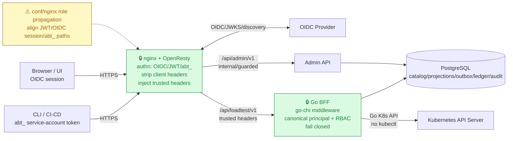
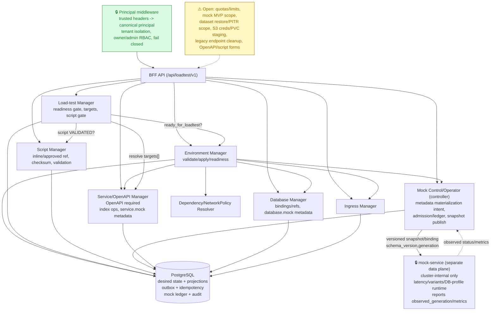
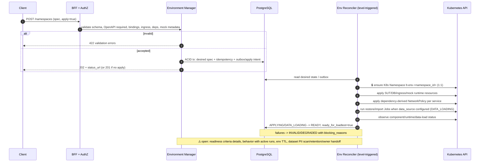
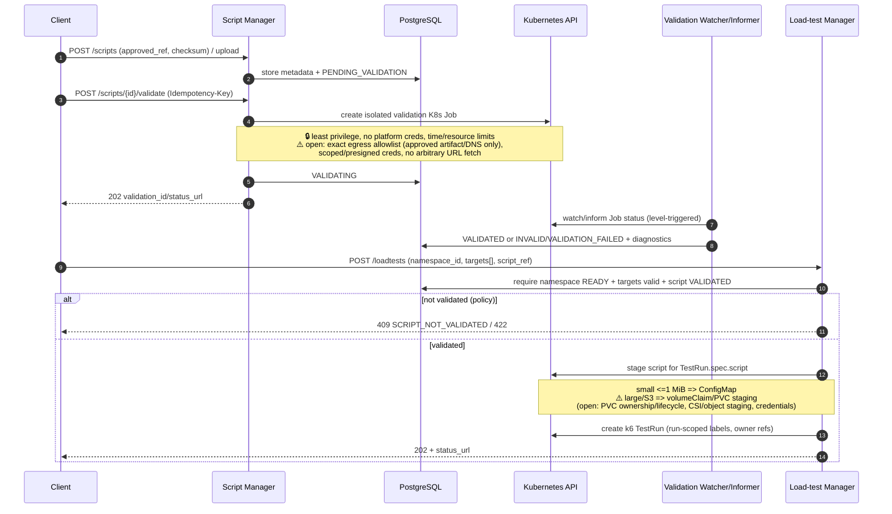

# Architecture — Self-Service Ephemeral Load Testing Platform (MVP BFF)

This document defines the **clear MVP architecture** for the platform. The model is **namespace-first**: an **Environment** (platform object; API path segment `/namespaces`) is the top-level definition that contains all components required for load testing; load tests are defined only against a **READY** Environment.

**Primary design & contracts**
- [`docs/namespace-management-api.md`](namespace-management-api.md) — namespace-first model and namespace/component CRUD/readiness API (primary contract).
- [`docs/bff-loadtest-api-spec.md`](bff-loadtest-api-spec.md) — BFF REST contract (`/api/loadtest/v1`).
- [`docs/loadtest-manager-api.md`](loadtest-manager-api.md) — load-test run lifecycle (gated by namespace readiness).
- [`docs/k6-operator-go-client.md`](k6-operator-go-client.md) — execute load via k6-operator `TestRun` using **Go Kubernetes API (no `kubectl`)**.
- [`docs/nginx-oidc-auth.md`](nginx-oidc-auth.md), [`docs/admin-oidc-integration-api.md`](admin-oidc-integration-api.md) — edge OIDC/JWT/tenant auth and `/api/admin/v1` integration; backend enforces owner/admin RBAC.
- Component detail/reference: [`docs/service-management-api.md`](service-management-api.md), [`docs/database-management-api.md`](database-management-api.md) (to be fully aligned to namespace-scoped model).

**MVP stack (`AGENTS.MD`):** Go + go-chi, Swagger/OpenAPI, PostgreSQL catalog/state (`sql/` migrations when implemented), nginx (`conf/nginx`) for routing/auth policy, Docker Compose, k6 performance testing. `sources/` is reference-only.

## 1. Goals

- Provide a **self-service BFF API** to define ephemeral test environments and run load tests safely.
- Make the environment model explicit: **the Environment defines everything** (services, databases, ingress, dependencies/network policy).
- Make API impact explicit: **each service has its own OpenAPI/Swagger**; a load test declares **which API operation(s)** it targets.
- Make execution explicit: a load test provides the **JS file (k6 script)** that defines the load.
- Ensure safety/readiness: namespace is **applied and READY** before load tests can be defined/run.
- Enforce security: user-scoped access, **tenant isolation always**, owner-only by default, **admin** cross-owner within tenant; dependency-derived **NetworkPolicy**; TTL/cleanup for ephemeral runs.

## 2. Domain model (clear)

```text
Environment (platform, top-level definition) — called "namespace" in API paths for now; distinct from a Kubernetes `Namespace` runtime resource
├── spec / desired definition
│   ├── services[]          (component CRUD)
│   │   ├── deploy/runtime config
│   │   ├── openapi         (REQUIRED: OpenAPI/Swagger contract for this service)
│   │   ├── database_bindings[] -> database_id
│   │   └── dependencies[]      -> service_id (drives NetworkPolicy)
│   ├── databases[]         (component CRUD, each has database_id)
│   ├── ingress[]           (component CRUD, routes to service_id/port)
│   └── dependency/network policy intent
├── status / readiness
│   ├── DRAFT|VALIDATING|INVALID|APPLYING|READY|DEGRADED|DELETING|DELETED
│   └── ready_for_loadtest (gate)
└── load tests[] (runs, allowed only when ready_for_loadtest=true)
    ├── targets[]           (REQUIRED: service_id + API operation(s) from OpenAPI)
    ├── script              (REQUIRED: JS/k6 file/definition)
    └── load_config, status, metrics, TTL/cleanup
```

### Key rules
1. **Environment-first (API: `/namespaces`):** define/manage namespace, then (or as part of it) CRUD services/databases/ingress.
2. **Service OpenAPI required:** each service carries its own OpenAPI/Swagger; platform validates/parses it and exposes operations for load-test targeting. Service/mock metadata over OpenAPI can define dependency behavior (latency profiles/variants) executed by the separate Mock Service (`docs/mock-service-api.md`).
3. **Dependencies -> NetworkPolicy:** service dependencies are validated and used to configure **NetworkPolicy per service** (least privilege; allow declared deps + required platform paths + load-test runner access as needed). Dependent services must be linkable/communicable under the namespace model (1 Environment = 1 K8s Namespace, MVP).
4. **Readiness gate:** namespace must be applied and `ready_for_loadtest=true` before load tests can be defined/triggered.
5. **Load test clarity:** every load test specifies **namespace + target API(s) + JS script + load config**.

## 2.1 Deployment units (MVP design, locked split)

The platform is split into **two services** (separate build/deploy units, same repo):

| | `loadtest-controller` (control plane) | `mock-service` (data plane) |
|---|---|---|
| Suggested source | `cmds/loadtest-controller/` + `pkgs/*` | `cmds/mock-service/` + `pkgs/*` |
| Role | BFF APIs, namespace/component CRUD, dataset/script/loadtest lifecycle, OpenAPI validation, NetworkPolicy/restore/script/TestRun orchestration, reconciler/reaper, RBAC | Run mock HTTP/DB-profile behavior: routing by OpenAPI operation/profile, variants, latency injection, pool concurrency enforcement, metrics |
| Load profile | Low/bursty (user/control operations) | High during load tests; latency-sensitive; scales by pool class |
| Source of truth | PostgreSQL (catalog, desired state, outbox, idempotency, ledger, projections, audit) | **No DB writes on hot path**; in-memory snapshot by `generation`/`schema_version` |
| Scale | Few replicas; leader election for reconcilers/reapers | Horizontal by pool class; `perf-isolated` may use dedicated node pool/taints/tolerations |
| Ingress | nginx → controller with trusted headers (POC locked, ADR-003) | **No public ingress**; cluster-internal endpoints/DNS only, exposed by dependency-derived NetworkPolicy |
| Auth | Principal middleware, tenant isolation, owner/admin RBAC | No user auth; cluster-internal trust (ServiceAccount/mTLS as implementation detail) |
| Failure isolation | Controller down: existing mock snapshots keep serving; control/apply slows | Mock-service degraded/down: namespace/mock status becomes `DEGRADED`; new runs blocked (`409 NAMESPACE_NOT_READY`); do not silently distort results |

**Interaction boundary (desired-state, not request-path coupling):**
- Controller stores canonical **mock metadata** in namespace components (`service.mock`/`database.mock`) and materializes runtime intent/binding state (DB projection/outbox). Controller/mock operator publishes **versioned snapshot/binding config** (e.g., CRD/ConfigMap/internal contract) with `schema_version`, `namespace_id`, `generation`, resolved bindings.
- `mock-service` watches/loads snapshots, swaps atomically, serves mock traffic, and reports `observed_generation`, health, and overhead metrics. It **must not** write PostgreSQL or make tenant/owner authorization decisions.
- Admin/control APIs for pools/status remain on controller; mock-service runtime endpoints are data-plane only.

**Repository layout (proposed, before implementation):**
```text
cmds/
  loadtest-controller/   # control-plane entrypoint (go-chi BFF, reconcilers, reaper wiring)
  mock-service/          # data-plane entrypoint (cluster-internal mock runtime)
pkgs/
  api/                   # HTTP handlers, middleware, request/response DTOs (controller)
  authz/                 # principal middleware, tenant/owner/admin RBAC (controller)
  namespace/             # environment/component validation/apply/readiness
  serviceopenapi/        # OpenAPI parse/index/target resolution
  database/              # database component + dataset/restore bindings
  script/                # script register/validate/staging metadata
  loadtest/              # load-test run lifecycle, targets/script gates
  mockcontrol/           # controller-side mock metadata materialization, snapshot publish, pool/ledger projections
  mockruntime/           # shared mock snapshot schema/types/runtime helpers (used carefully; mock-service stays independent of controller HTTP/DB)
  k8s/                   # Kubernetes client/adapters (TestRun, Jobs, NetworkPolicy, watchers) — no kubectl
  store/                 # PostgreSQL access/projections/outbox/idempotency/ledger interfaces
docs/                    # architecture/contracts/decisions (update before plan/code)
plans/                   # implementation plans/design notes (write before code)
sql/                     # migrations only (after plan/docs, before/during implementation as needed)
tests/                   # unit/integration/perf tests
```
Layout is finalized in `plans/` before writing code; `mockruntime` shared code must not introduce controller DB/authz coupling into `mock-service`.

## 3. Architecture diagrams (review set)

**Legend:** 🔒 locked, ⚠️ open/risk to close before implementation, ✅ normal flow. Reflects locked MVP decisions and namespace-first contracts.

**Locked decisions:** (1) **1 Environment = 1 K8s Namespace** (`lt-env-<namespace_id>`, deterministic labels); (2) **runner egress is network-enforced** (run-scoped NetworkPolicy, default deny; `targets[]` validated metadata, not advisory); (3) **POC uses OIDC/nginx auth** — nginx reflects identity/permissions into trusted headers, Go go-chi middleware builds canonical principal and enforces RBAC/tenant isolation/fail-closed; `tenant_id` boundary, `abt_` service-account/CLI token; (4) **mock execution is a separate `mock-service` data plane**, controlled by `loadtest-controller` via desired-state snapshots/bindings (no request-path coupling).

### 3.1 Context & trust boundary



**Review:** trusted boundary is enforced only if nginx strips client `X-Tenant-Id/X-User-*` and backend rejects missing headers; admin normalization must be consistent across auth paths.

### 3.2 Control plane (Go components)



### 3.3 Environment lifecycle (create → READY)



### 3.4 Script validation & staging (S3/approved ref)



### 3.5 Load-test execution & runner egress (security review focus)

```mermaid
flowchart LR
  subgraph ENVNS["🔒 K8s Namespace lt-env-<namespace_id> (ADR-001, 1:1)"]
    direction TB
    subgraph RUN["Run-scoped resources"]
      TR["k6 TestRun CRD"] --> RUNNER["🔒 runner pods<br/>untrusted JS<br/>no K8s/platform creds<br/>least-privilege SA"]
      STG["staged script<br/>ConfigMap or PVC"] --> TR
      NPR["🔒 NetworkPolicy egress<br/>run-scoped selector<br/>DEFAULT DENY<br/>allow: resolved targets + approved deps/mocks + DNS"] -.->|enforces| RUNNER
    end
    subgraph SUTS["Environment components"]
      SUT["SUT workloads"]
      MOCK["mock-service runtime/endpoints<br/>materialized from service.mock/database.mock metadata"]
      DB["DB (real or mock, unambiguous)"]
      NPS["NetworkPolicy per service<br/>dependency-derived"] -.-> SUT
      SUT --> DB
      SUT --> MOCK
    end
    PAR["⚠️ open: parallel run quota/limits,<br/>label isolation in shared namespace,<br/>per-run namespace later if needed"] -.-> RUN
  end

  RUNNER ==>|allowed: resolved targets[]| SUT
  RUNNER -.->|allowed: approved deps/mocks| MOCK
  RUNNER -.->|allowed: DNS| DNS["cluster DNS"]
  RUNNER -. "blocked" .-x EXT["other namespaces / internet / metadata / K6/K8s API"]

  classDef locked fill:#dafbe1,stroke:#1a7f37,color:#1a7f37;
  classDef risk fill:#ffebe9,stroke:#cf222e,color:#cf222e;
  classDef open fill:#fff8c5,stroke:#9a6700,color:#9a6700;
  class NPR,RUNNER locked;
  class EXT risk;
  class PAR open;
```

### 3.6 Review checklist
| Area | Review question | Status |
|---|---|---|
| Trust boundary | nginx strips client identity headers; backend fails closed on protected routes? | 🔒 design / ⚠️ `conf/nginx` impl alignment |
| AuthN/AuthZ | OIDC/nginx reflects permissions; Go middleware canonical principal + RBAC? | 🔒 ADR-003 |
| Role propagation | `X-User-Role`/admin signals consistent across JWT bearer, OIDC session, `abt_` introspection? | ⚠️ |
| Env mapping | 1 Environment = 1 K8s Namespace, deterministic labels, scoped cleanup? | 🔒 ADR-001 |
| Runner egress | run-scoped NetworkPolicy default deny, resolved targets+deps+mocks+DNS only? | 🔒 ADR-002 / ⚠️ CNI resolution details |
| Script validation | approved refs only, checksum, isolated Job, watcher projection, gate before run? | ✅ flow / ⚠️ allowlist+creds details |
| Large scripts | >1 MiB/S3: `volumeClaim` staging, PVC ownership/lifecycle, presigned/scoped creds? | ⚠️ |
| Parallel runs | quota/limits, label isolation, owner refs/reaper in shared Env namespace? | ⚠️ |
| Mock model | metadata in `service.mock`/`database.mock`; mock runtime is separate `mock-service`; real-vs-mock unambiguous? | ✅ model / ⚠️ snapshot contract + MVP scope |
| Snapshot contract | `schema_version`, generation/observed_generation, compatibility and rollback behavior defined? | ⚠️ |
| Mock benchmark | `rps_per_core`/overhead measured before final mock-service language/runtime choices? | ⚠️ |

**Trust boundary:** nginx authenticates and resolves tenant/identity; BFF trusts injected headers only at the trusted boundary and enforces authorization (owner/admin, tenant isolation).

## 4. BFF component responsibilities

| Component (`cmds/`/`pkgs/`) | Responsibility |
|---|---|
| HTTP API (go-chi + Swagger) | Namespace/component CRUD, readiness, load-test create/manage, consistent errors, OpenAPI docs. |
| Auth middleware | Extract `X-Tenant-Id`, `X-User-Id`, role/admin signals; build principal; fail closed. |
| Authz policy | Tenant isolation; owner-only; admin cross-owner within tenant; consistent 401/403/404 policy. |
| Environment manager | Store/validate/apply namespace definitions; compute readiness from component statuses; expose `ready_for_loadtest`. |
| Service/OpenAPI manager | Validate/store service definitions; **require/parse OpenAPI/Swagger**; index operations for target selection; validate/service store `service.mock` metadata. |
| Database manager | CRUD, validation, bindings/secret refs, `database.mock` metadata validation/storage, managed dataset refs/restore policy validation, data-load status. |
| Dataset manager | Register/validate managed non-prod datasets (S3 approved refs, checksum, owner/tenant RBAC), expose metadata/status for restore; no prod-source policy. |
| Ingress manager | CRUD, validation, host/path/TLS/rule resolution to services/ports, status. |
| Dependency/NetworkPolicy resolver | Validate dependency graph; render/apply NetworkPolicy per service from dependencies; expose effective policy/status. |
| Load-test manager | Enforce readiness gate; validate `targets[]` against namespace OpenAPI; validate/accept required **JS script** (inline or approved ref such as S3/object ref); enforce validation gate for remote refs; apply guardrails; persist and orchestrate runs. |
| K8s orchestrator/adapter | Apply/reconcile namespace components and run resources via **Go Kubernetes API** (no kubectl): namespace/policies/ingress/db/app resources as applicable, script validation **K8s Jobs** + watcher/informer reconciliation, script staging (ConfigMap for small / volumeClaim for large S3/object-ref scripts), **k6-operator `TestRun`** (`docs/k6-operator-go-client.md`), TTL cleanup. |
| Mock operator (controller) | Materializes `service.mock`/`database.mock` metadata into versioned snapshots/bindings, admission/ledger integration, reconcile/`observed_generation`, pool/admin projections; integrates with namespace deps/NetworkPolicy (`docs/mock-service-api.md`). |
| `mock-service` runtime (separate deployable) | Loads snapshots, serves cluster-internal mock endpoints (OpenAPI/DB profiles), applies latency/variants, enforces pool concurrency, exports overhead/health/observed status. No public ingress, no user RBAC, no PostgreSQL hot-path writes. |
| Telemetry adapter | Authz-scoped logs/metrics/events/artifacts; redact secrets. |

## 5. Core flows

### 5.1 Define namespace (everything in one place)
1. Client creates namespace (`POST /namespaces (Environment)`) with full `spec` (services+OpenAPI, databases, ingress, dependency policy) and/or adds components via CRUD.
2. BFF validates: schema, service OpenAPI (required), DB bindings, ingress targets, dependency references/graph, NetworkPolicy renderability. Apply target is the Environment’s mapped K8s Namespace (1:1).
3. BFF applies/reconciles desired state asynchronously (`APPLYING`).
4. BFF tracks component readiness and sets `READY` + `ready_for_loadtest=true` only when required checks pass. Errors -> `INVALID`/`DEGRADED` with reasons.

### 5.2 Define/trigger load test (only when namespace READY)
1. Client submits `POST /loadtests` with `namespace_id`, **`targets[]`** (API operations), **`script` (JS)**, and `load_config`.
2. BFF checks authz and **namespace readiness gate** (`ready_for_loadtest=true`) — reject if not ready (**`409 Conflict`**, code `NAMESPACE_NOT_READY`, with readiness details).
3. BFF resolves `targets[]` against namespace services’ parsed OpenAPI; rejects unknown/invalid targets.
4. BFF validates JS script and guardrails. If `script_ref` (e.g., S3/approved artifact) is used, require `VALIDATED` status from async validation (isolated **K8s Job**, reconciled by **K8s watcher/informer**) before execution; stage validated content to `configMap` (<=1 MiB) or `volumeClaim` for `TestRun.spec.script`.
5. BFF persists run, provisions/executes asynchronously (ensure runner/network access, create script source, create k6 `TestRun` via Go K8s API), returns `202` + `status_url`.
6. BFF reconciles status to terminal state (`COMPLETED/FAILED/STOPPED/TIMEOUT_CLEANED/CLEANUP_FAILED`) and performs TTL/stop cleanup.

## 6. API surface (summary)

Base: `/api/loadtest/v1` (details in `docs/bff-loadtest-api-spec.md`).

- **Namespaces:** create/replace/list/get/readiness/validate/apply/delete — `/namespaces...`
- **Namespace components (CRUD):** `/namespaces/{namespace_id}/services` (service includes **OpenAPI**; exposes `/openapi`, `/apis`), `/databases`, `/ingress`; `/dependencies`, `/network-policies`.
- **Load tests:** `/loadtests` create requires ready Environment + `targets[]` + JS `script`; list/get/stop/logs (+ inferred events/metrics/rerun/delete). Remote/S3 scripts use approved refs, async **K8s Job validation + watcher** notification/status, and staging to `configMap`/`volumeClaim` (k6-operator has no native S3 source).
- **Mock service (separate runtime):** materializes `service.mock`/`database.mock` metadata from namespace components (pools, reservations, latency/variants/profiles), ACID async writes, reservation ledger, pooled runtime, operator reconcile — see `docs/mock-service-api.md`.
- **Supporting:** `/me`, `/guardrails`, health/metrics.
- **Control plane:** `/api/admin/v1` for OIDC/tenant/auth-config/introspection/account/role integration.

## 7. Security & operations

**Integrity/fault harness (release gate):** see [`docs/harness-testing.md`](harness-testing.md) for ACID/invariant proofs, crash/exception/network-fault scenarios, idempotency/retry/runner safety, and CI placement. These complement unit/E2E/k6 perf tests.

- Trust only nginx-injected identity at the boundary; fail closed; never trust client owner/tenant. **Enforce trust boundary:** backend reachable only via trusted nginx path (unix socket/private upstream) and/or nginx strips client-supplied `X-Tenant-Id`/`X-User-*` and sets them; backend rejects requests missing required headers on protected routes.
- Tenant isolation always; owner/admin RBAC in BFF.
- Service OpenAPI, JS scripts, and target refs are validated and size/guardrail-limited. **JS scripts are untrusted:** `targets[]` metadata is validated, but script behavior must be constrained by **runner NetworkPolicy/egress allowlists** (only resolved targets/declared deps + required platform endpoints), no platform/K8s credentials in runner, resource/time/size quotas (ConfigMap 1 MiB, script size, vusers/duration), and SSRF-safe target resolution.
- NetworkPolicy is dependency-derived (least privilege); review baseline CNI/platform allowances.
- Secrets via refs/secret stores (never commit raw secrets).
- Async/idempotent operations (define `Idempotency-Key` on create/trigger/apply/stop endpoints), readiness checks, TTL/force-stop cleanup, **Environment TTL** (ephemeral definitions need TTL or explicit retention to avoid leaks), audit for admin actions, optimistic concurrency/version/ETag for conflicting updates/applies.

## 8. MVP decisions (locked for design/docs) and remaining open items

### Locked (MVP design)
1. **Environment ↔ Kubernetes Namespace mapping = 1:1 (critical).** One platform Environment (`/api/loadtest/v1/namespaces`, `namespace_id`) maps to **one Kubernetes Namespace** (deterministic name, e.g. `lt-env-<namespace_id>` normalized; labels `tenant_id`, `namespace_id`, `managed-by`). Environment components (services, databases, ingress, dependency-derived NetworkPolicy, mock runtime components as applicable) are reconciled in that K8s Namespace. Load-test execution resources run in the same Environment K8s Namespace unless a future decision isolates per-run namespaces; in all cases cleanup/TTL is Environment-scoped and runner isolation/egress rules still apply.
2. **Runner egress is network-enforced (not advisory).** `targets[]` is validated against namespace OpenAPI for audit/UX, but **k6 JS is untrusted**. For each run, resolve allowed destinations from `targets[]` + approved namespace deps/mocks + required platform allowances (DNS). Apply **NetworkPolicy egress for runner pods** (run-scoped selector/labels): default deny egress, allow only resolved service/mock endpoints/ports and required DNS; no K8s API/platform credentials, least-privilege SA. Hostname/external-target policy (if ever allowed) must be explicit and SSRF-safe.
3. **AuthN/AuthZ integration (locked direction).** `tenant_id` scopes the multi-domain loadtest service (org/tenant boundary) and is always applied. `abt_` is a platform-issued service-account/base token (CLI/automation). **POC uses OIDC/nginx auth** (`conf/nginx`, OpenResty/Lua pattern): nginx authenticates (OIDC/JWT/`abt_` as applicable) and **reflects permissions/identity from OIDC/claims/introspection into trusted headers**. The Go BFF (go-chi) **still has a middleware layer** to extract trusted headers, build canonical principal (`tenant_id`, `user_id`/principal, `is_admin`, roles), enforce RBAC/tenant isolation, and fail closed. **Admin normalization is canonical** (one rule) and never derived from untrusted client input. Target/prod keeps the same trust-boundary contract (nginx edge + Go RBAC enforcement).

### Remaining open items
1. Readiness criteria for `ready_for_loadtest` and degraded behavior; behavior when mutating Environment with active runs.
2. Dependency/NetworkPolicy baseline merge with cluster DNS/metrics/system rules (CNI specifics).
3. Concrete quota/limits (OpenAPI/script max, ConfigMap 1 MiB vs `volumeClaim` staging, vusers/duration/TTL, env TTL, validation Job limits).
4. OpenAPI/script forms and operation identifier format (`operationId` vs `method+path`) finalized in contracts.
5. Dataset/restore (MVP dump-file default): approved non-prod S3 refs, credential model (IRSA/scoped short-lived/presigned), verify/checksum/schema checks, PII pattern scan on import, retention/owner handoff, restore Job egress allowlist; `snapshot_per_run`/non-prod PITR roadmap.
6. Mock Service MVP scope (separate `mock-service` deployable, metadata materialization now; snapshot/binding contract; capacity ledger/benchmark depth phased) and mock endpoint DNS/NetworkPolicy templates.
7. Compatibility strategy for legacy/global endpoints in older docs.