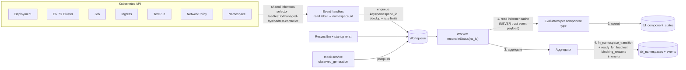

# Namespace Status Watcher — observed state (K8s) → Postgres

This document defines the **observed → Postgres** loop: who computes readiness, where the data comes from, and where it is written. It is the inverse of [`k8s-orchestration.md`](k8s-orchestration.md) (desired → K8s) and the **data source** for the readiness payload in [`namespace-management-api.md`](namespace-management-api.md) §3 (`GET /readiness` is projection-backed, not computed on the fly).

**Scope:** design locked (plans/20); **implemented in plans/21/22** — migration 0011 (`tbl_component_status` + namespace columns + seed transition delta), `pkgs/statuswatcher` (evaluators, projection, aggregator, hysteresis, STATUS_STALE gate), Watch→workqueue event source, apply_deadline, DEGRADED-with-running-run. **WATCH-01..06 harness cases: implemented** — fake-client cases chạy trong CI job `test`, real-cluster cases trên kind trong job `integration-k8s` (`tests/harness/watcher/`, plans/22). 🔜 còn lại: informer-cache sharing đa replica / leader-sharding, restore Job (INT-LOOP-02/03).

## 1. Two separated loops

| | Env Reconciler (see `k8s-orchestration.md` §4) | **Status Watcher (this doc)** |
|---|---|---|
| Direction | desired (PG) → K8s | observed (K8s) → PG |
| Writes to | K8s (SSA) | **PG only** (projection + transition) |
| Triggered by | outbox/apply intent, spec change | informer events + periodic resync |
| Responsibility | render/apply/prune resources | evaluate per-component phase, aggregate namespace status |

The two loops **communicate only via the DB**: the Reconciler bumps `desired_generation` (and writes `spec_hash`); the Watcher reads and compares against `observed_generation` on K8s. The Watcher **never writes K8s** — easy to test (fake informers + fake client), easy to fail safe (a dead watcher cannot damage the cluster; it only makes status stale — §7).

## 2. Data model (migration sketch — actual migration in plan 21)

```sql
-- projection, 1 row / component
CREATE TABLE tbl_component_status (
    id                   UUID PRIMARY KEY DEFAULT gen_random_uuid(),
    namespace_id         UUID NOT NULL REFERENCES tbl_namespaces(id),
    component_type       TEXT NOT NULL CHECK (component_type IN
        ('service','database','data_load','ingress','network_policy','mock')),
    component_id         TEXT NOT NULL,          -- svc-.../db-.../ing-...
    required             BOOLEAN NOT NULL DEFAULT true,
    desired_generation   BIGINT NOT NULL DEFAULT 0,
    observed_generation  BIGINT NOT NULL DEFAULT 0,
    phase                TEXT NOT NULL CHECK (phase IN
        ('PENDING','PROGRESSING','READY','FAILED','UNKNOWN')),
    reason               TEXT,                   -- e.g. image_pull_backoff, STATUS_STALE
    message              TEXT,
    last_transition_at   TIMESTAMPTZ,
    observed_at          TIMESTAMPTZ NOT NULL DEFAULT now(),
    UNIQUE (namespace_id, component_type, component_id)
);
-- (if existing component tables use UUID PKs: use the component UUID instead of
--  component_id text — to be finalized in the migration)

ALTER TABLE tbl_namespaces
    ADD COLUMN desired_generation BIGINT NOT NULL DEFAULT 0,  -- bumped on every spec change / apply
    ADD COLUMN blocking_reasons   JSONB,                      -- source for GET /readiness
    ADD COLUMN status_observed_at TIMESTAMPTZ;                -- watcher heartbeat
```

**`tbl_status_transitions` seeds to add** (the current seed at `sql/0003:63-75` is not enough for the watcher):

| Transition | Current state | Note |
|---|---|---|
| `APPLYING → READY` | **missing** | namespace without `data_source` |
| `APPLYING → DEGRADED` | **missing** | permanent component failure during apply |
| `DATA_LOADING → INVALID` | **missing** | hard restore failure |
| `DEGRADED → READY` | **missing** | stable recovery (§5); note the seed already has `DEGRADED → VALIDATING` (re-validate path) — keep both |
| `APPLYING → DATA_LOADING`, `DATA_LOADING → READY`, `READY → DEGRADED`, `… → DELETING`, `DELETING → DELETED` | already present | unchanged |

## 3. Watcher architecture



- **Level-triggered:** events only enqueue the key `namespace_id`; the worker always recomputes everything from the current informer cache. Lost, duplicated, or reordered events still converge. Periodic resync (5m) and startup relist are the safety net.
- **One watcher, many evaluators:** registered per GVR (`apps/v1 Deployment`, `postgresql.cnpg.io/v1 Cluster`, `batch/v1 Job`, `networking.k8s.io/v1 Ingress`, `k6.io/v1alpha1 TestRun`, NetworkPolicy). The same infrastructure serves `fn_loadtest_transition` (TestRun `status.stage`) and the script validation Job — **no second watcher**.
- **Leader election:** every replica holds the informer cache (readable); only the leader writes the DB (or shard by hash of `namespace_id`).
- The worker reads **from the cache**, never the event payload — avoids stale/duplicate payloads, matching the harness "stale reads" hook.

## 4. Evaluator: what "component ready" means

| Component | READY when | FAILED when |
|---|---|---|
| service | `Deployment.status.observedGeneration == metadata.generation`, condition `Available=True`, `availableReplicas >= replicas`, `spec_hash` annotation matches DB | `ProgressDeadlineExceeded`, prolonged CrashLoopBackOff |
| database | CNPG Cluster condition `Ready=True`, app secret exists (name only — see `k8s-orchestration.md` §3.2) | error phase / deadline exceeded |
| data_load | Restore Job `Complete=True` and verify passed | Job `Failed` (backoffLimit exhausted) or past `activeDeadlineSeconds` |
| ingress | object exists, `spec_hash` matches | missing after apply |
| network_policy | **K8s has no status** → "applied" = full expected policy set exists with matching `spec_hash` | missing / hash mismatch (drift) |
| mock | mock-service reports `observed_generation == snapshot generation` | snapshot rejected (`schema_version` error) |

**Generation fencing:** a component is only counted READY when `observed_generation == desired_generation` of the namespace. Otherwise it is at most `PROGRESSING`. This blocks "spec was edited but the watcher read the old generation's READY state and reported READY" (harness `WATCH-03`).

## 5. Namespace aggregation rules

```text
APPLYING     → all required components READY (except data_load)
               and data_load still in progress   → DATA_LOADING
APPLYING | DATA_LOADING → all READY             → READY  (ready_for_loadtest=true)
APPLYING | DATA_LOADING → any permanent FAILED  → INVALID (blocking_reasons)
APPLYING | DATA_LOADING → past apply_deadline   → DEGRADED/INVALID
READY        → a required component not READY
               continuously > grace window (60s) → DEGRADED (ready_for_loadtest=false)
READY        → DELETING/DEGRADED/INVALID         → ready_for_loadtest được clear trong cùng transition (fn_namespace_transition, sql/0013); chk_namespaces_ready_only_when_ready (sql/0012) là backstop.
DEGRADED     → all READY stable > stable window (60s) → READY
DELETING     → K8s Namespace gone               → DELETED
```

- **Required:** every component type including mock/ingress (locked decision — their failure also blocks READY). Future optional components would only contribute `blocking_reasons`, not block.
- **Vacuous namespaces:** a namespace with **zero required components** (no services, no databases, no declared dependencies) never becomes READY — `allReady` requires `requiredCount > 0`. Optional component rows (data_load/ingress/policy) existing alone cannot drive READY (fail-closed).
- **Hysteresis:** rolling updates / pod restarts make `availableReplicas` fluctuate; without grace/stable windows the namespace flaps READY↔DEGRADED and load tests get blocked spuriously (`WATCH-06`).
- **Atomic write:** `status`, `version`, `ready_for_loadtest`, `blocking_reasons` and the event are written in **one transaction** via `fn_namespace_transition` (`sql/0003_namespace_component.sql`) — matches DB-TXN-01/02. An illegal transition raises; the watcher logs it and recomputes on the next pass (no crash loop).
- **DEGRADED → READY vs DEGRADED → VALIDATING:** both paths are valid — back to READY for transient failures (stable window); `VALIDATING` when the spec was edited (path already in the seed).

## 6. Policy when a namespace goes DEGRADED with a RUNNING load test

**Decision: the run continues, its result is flagged unreliable.**

- The watcher/reaper **does not stop** the run. A RUNNING run is marked (meta/event `namespace_degraded_at`) so reports flag "result not trustworthy" — same spirit as `mock-service-api.md` §1.1 (degraded mock pool → results unreliable).
- The `POST /loadtests` gate is unchanged: it still requires `ready_for_loadtest=true` at run-creation time.
- Rationale: killing a run mid-flight yields half-finished results; stopping is the user's call.

## 7. Fail-closed when the watcher dies

Today the gate only reads `ready_for_loadtest` — if the watcher stops, a namespace can show READY while actually broken. Defense in depth (matches DB-TXN-10):

- The watcher updates `status_observed_at` on every reconcile/resync (per-namespace heartbeat).
- `POST /loadtests` treats the namespace as **not ready** when `now - status_observed_at > staleness_threshold` (default 15m = 3× resync), returning `409 NAMESPACE_NOT_READY` with reason `STATUS_STALE`.

## 8. Configuration

| Parameter | Default | Meaning |
|---|---|---|
| `WATCHER_GRACE_WINDOW` | `60s` | max time not-READY before DEGRADED |
| `WATCHER_STABLE_WINDOW` | `60s` | READY-stable time before leaving DEGRADED |
| `WATCHER_APPLY_DEADLINE` | `15m` | APPLYING/DATA_LOADING overdue → DEGRADED/INVALID |
| `WATCHER_RESYNC_PERIOD` | `5m` | informer resync |
| `WATCHER_STALENESS_THRESHOLD` | `15m` | heartbeat overdue → gate `STATUS_STALE` |

All configurable via controller env/config.

## 9. Harness tests (implemented — plans/21 PR E fake-client cases + plans/22 colima/kind harness)

| ID | Scenario |
|---|---|
| `WATCH-01` | Drop events mid-flight → resync still converges to the correct status |
| `WATCH-02` | Duplicate / reordered events → result unchanged |
| `WATCH-03` | Spec edited → the old generation's READY status must not count (generation fencing) |
| `WATCH-04` | Watcher crashes between upsert and transition → restart converges, no duplicate event |
| `WATCH-05` | Watcher stopped → gate returns `STATUS_STALE` instead of READY |
| `WATCH-06` | Component flaps within the grace window → no DEGRADED emitted |
